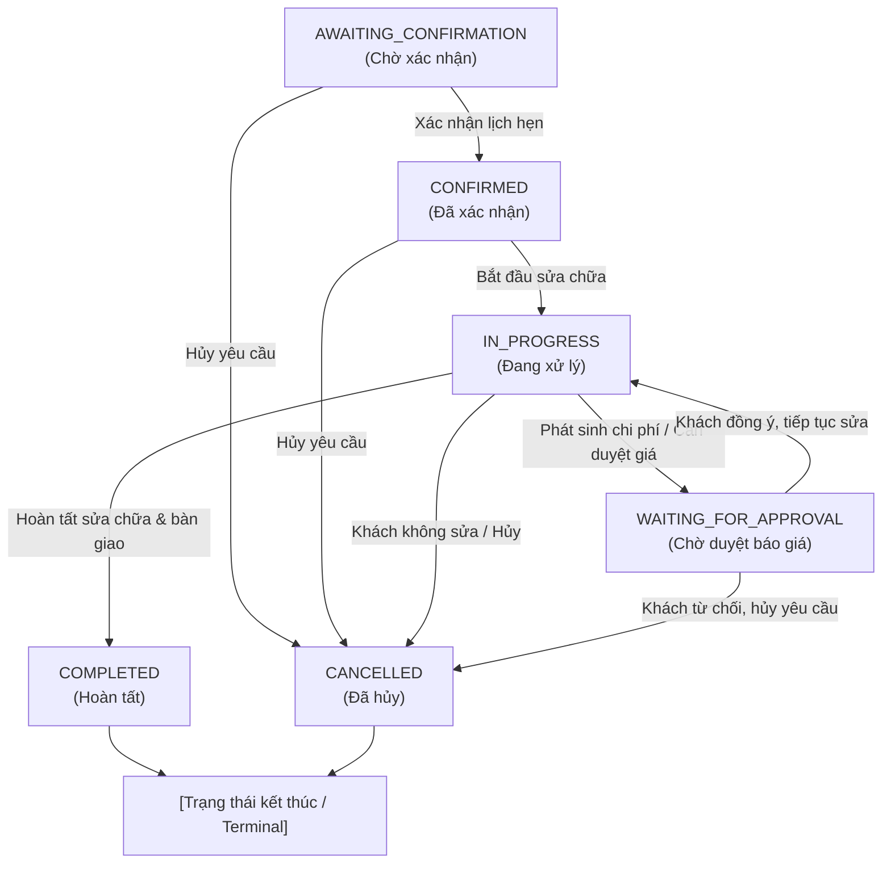

# MQTech Website — Phase P3 Implementation Report

- **Document Version:** 1.0.0
- **Date:** 2026-10-30
- **Auditor & Implementer:** Senior AI Engineering Infrastructure Architect
- **Phase:** Phase P3 (Administrative Intake Triage & Status Management)
- **Status:** **COMPLETE & VERIFIED — READY FOR P4 REVIEW**
- **Repository:** `D:\1.Project\MQTechWeb`

---

## 1. Executive Summary & Gate Status

Phase P3 has been implemented in strict adherence to the project requirements, architecture rules, and security guidelines:
- **Scope Delivery:** Established a minimal, secure administrative triage workspace for MQTech technicians and managers to review incoming service requests, inspect technical and contact details, transition repair statuses according to an enforced lifecycle, and review an immutable audit history of all state changes.
- **Safety Boundary Preservation:** No production resources were modified. The existing Fly.io OpenWebUI application (`openwebui-mqtech`) and its attached volume (`vol_4m3m9jdgen55793v`) remain completely untouched and unreferenced.
- **Anti-Bloat Discipline:** Avoided building an unnecessary full-featured CRM, customer billing module, or complex multi-tenant RBAC system. The administrative interface is lightweight, focused solely on intake triage, status lifecycle management, and operational clarity.
- **Quality Gates:** 100% passed across all verification checks:
  - Unit & Integration Test Suites: **57 / 57 tests passing** across 12 test suites.
  - TypeScript Strict Mode (`tsc --noEmit`): **0 errors**.
  - ESLint 9 (`eslint`): **0 errors, 0 warnings**.
  - Production Build (`next build` with Turbopack & PPR): **Exit code 0**; all 14 routes statically generated, partially prerendered, or dynamically rendered.

---

## 2. Preflight Verification Record

Prior to implementing administrative capabilities, independent verification was performed:
1. **P2 Deliverable Integrity:** All public website components, dual-mode intake forms, rate limiters, cryptographically secure reference code generators (`MQT-XXXXXX`), and initial status `AWAITING_CONFIRMATION` ("Chờ xác nhận") were inspected and verified operational.
2. **Environment & Host Inspection:** Confirmed that the local Windows host does not have a native PostgreSQL service or container runtime (Docker/Podman).
3. **Database Isolation Enforcement:** Reaffirmed the rule *"Never connect the application to the existing Fly.io OpenWebUI application"*. The repository uses a dual-adapter pattern: parameterized SQL when `DATABASE_URL` is explicitly configured to an authorized development PostgreSQL instance, and an isolated, in-memory repository store for local development and automated testing.
4. **Git Baseline:** Verified clean working tree before implementation, starting from commit `e73aab2` (`feat(p2): complete public website...`).

---

## 3. Authentication & Session Architecture

The administrative authentication mechanism follows security best practices without introducing heavy third-party authentication services:

### 3.1 Password Hashing & Verification (`src/lib/auth/password.ts`)
- **Algorithm:** Node.js native `crypto.scrypt` with a 16-byte cryptographically secure random salt generated via `crypto.randomBytes(16)`.
- **Derived Key Length:** 64 bytes.
- **Storage Format:** `salt:derivedKey` encoded in hexadecimal format.
- **Timing-Attack Resistance:** Password verification uses `crypto.timingSafeEqual` over buffers of equal length to eliminate side-channel timing leaks.
- **Password Strength Rule:** Enforces a minimum length of 8 characters.

### 3.2 Stateless HMAC-SHA256 Session Cookie (`src/lib/auth/session.ts`)
- **Cookie Name:** `mqtech_admin_session`.
- **Security Attributes:** `HttpOnly; SameSite=Lax; Path=/; Max-Age=28800` (8 hours). In production environments (`NODE_ENV === "production"`), the `Secure` flag is enforced.
- **Signature Mechanism:** HMAC-SHA256 over `base64url(payload)` using a server-side secret (`ADMIN_SESSION_SECRET` or cryptographically random fallback in development).
- **Tamper Protection:** The signature is verified using `crypto.timingSafeEqual`. Any alteration to payload, role, username, or timestamp results in immediate token rejection.
- **Session Expiry:** Explicit timestamps (`expiresAt`) are validated during every request; expired tokens return `null`.

### 3.3 Brute-Force Rate Limiting (`src/lib/auth/admin-service.ts`)
- **Login Rate Limiter:** Protects `/api/admin/login` by restricting login attempts to **5 attempts per 15-minute sliding window per IP address**.
- **Threshold Exceeded:** Returns HTTP 429 (`Too Many Requests`) with clear Vietnamese error notification.

### 3.4 Offline Administrator Bootstrapper (`scripts/bootstrap-admin.mjs`)
- An administrative CLI utility allowing initial admin account creation or reset offline without exposing plain-text credentials in code or repository commits:
  ```bash
  node scripts/bootstrap-admin.mjs [username] [password]
  ```
- Defaults to environment variables `ADMIN_INIT_USERNAME` and `ADMIN_INIT_PASSWORD` if CLI arguments are omitted.

---

## 4. Administrative Route & Page Implementation

### 4.1 Login Route (`src/app/admin/login/page.tsx` & `/api/admin/login`)
- **Design Alignment:** Styled using MQTech's dark tech theme (`#0A0A0B`, `#111113`, pure white primary accents, neutral borders).
- **User Experience:**
  - Dedicated administrative header with security shield icon and MQTech badge.
  - Autofocus username and password inputs with high-contrast active states.
  - Interactive submit button with loading spinner and disabled state during authentication.
  - Clear Vietnamese error feedback for invalid credentials or rate limiting.
  - "Quay lại trang chủ" navigation link to return to the public website.

### 4.2 Server-Side Protected Shell (`src/app/admin/page.tsx`)
- **Partial Prerendering Compatibility:** Uses React `<Suspense>` around the server data boundary (`AdminProtectedShell`), allowing Next.js 16 to statically prerender the initial visual container while dynamically streaming the authenticated session state.
- **Authorization Check:** Server-side verification of the `mqtech_admin_session` cookie; unauthenticated users are immediately redirected via `redirect("/admin/login")`.
- **SEO & Indexation Control:** Explicit metadata instructs search engines not to crawl or index the admin interface:
  ```typescript
  robots: { index: false, follow: false }
  ```

### 4.3 Administrative Navigation & Logout
- Top navigation bar featuring the MQTech Admin badge, current user identity (`fullName` and `role`), external link to the live public website (`target="_blank"`), and a secure one-click logout action (`POST /api/admin/logout`) that clears the session cookie with `Max-Age=0`.

---

## 5. Dashboard & Request Management (`src/components/admin/AdminDashboardClient.tsx`)

The administrative workspace is engineered for operational efficiency and clarity:

### 5.1 Metrics Summary Ribbon
Displays real-time count cards reflecting actual persisted records in the repository:
1. **Tất cả yêu cầu:** Total intake count across all states.
2. **Chờ xác nhận:** Initial intake state requiring customer contact (`AWAITING_CONFIRMATION`).
3. **Đã xác nhận:** Contact established, service appointment confirmed (`CONFIRMED`).
4. **Đang xử lý:** Technician diagnosing or actively repairing device (`IN_PROGRESS`).
5. **Chờ duyệt báo giá:** Diagnostic complete, awaiting customer quote approval (`WAITING_FOR_APPROVAL`).
6. **Hoàn tất:** Device repaired, tested, and returned to customer (`COMPLETED`).
7. **Đã hủy:** Request cancelled by customer or technician (`CANCELLED`).

### 5.2 Triage Controls & Search Toolbar
- **Search Bar:** Real-time search across reference codes (`MQT-XXXXXX`), customer phone numbers, and customer names.
- **Status Filter:** Dropdown to filter by any specific lifecycle state.
- **Delivery Mode Filter:** Dropdown to isolate **Mang máy đến tiệm** (`IN_STORE`) vs **Sửa chữa tận nơi** (`ON_SITE`).
- **Refresh Action:** Instant manual refresh trigger to synchronize live data.

### 5.3 Paginated Request Table
- **Reference Code Badge:** High-contrast monospace code (`MQT-XXXXXX`) for rapid ticket identification.
- **Customer Information:** Displays customer name and clickable telephone link (`tel:...`) for rapid mobile/Zalo outreach.
- **Device & Service:** Clear device category icon/tag (`LAPTOP`, `PC_DESKTOP`, etc.) paired with the confirmed MQTech service title.
- **Delivery Mode Badge:** Distinct visual distinction between in-store drop-offs and on-site service calls.
- **Status Pill:** Color-coded status badge indicating the current operational state.
- **Time Stamp:** Localized Vietnamese timestamp (`dd/mm/yyyy hh:mm`).
- **Triage Action:** "Xử lý" button opening the full request inspection modal.

### 5.4 Inspection & Status Transition Modal
When a request is selected, the triage modal provides:
- **Comprehensive Summary:** Customer details, telephone, preferred contact time, delivery mode, and service address (for on-site requests).
- **Issue Description:** Full unedited customer problem statement.
- **Internal Admin Notes:** Field displaying technician notes.
- **Lifecycle Transition Form:** Dropdown presenting **only the strictly valid next statuses** permitted from the current state.
- **Transition Note Input:** Optional explanation note recorded in the audit log.
- **Status History Audit Timeline:** Chronological timeline displaying every prior state transition, the user who authorized the change (`changedBy`), the timestamp, and any attached notes.

---

## 6. Status Lifecycle & Transition Logic (`src/lib/constants/status-lifecycle.ts`)

The status lifecycle strictly enforces business constraints and prevents arbitrary jumps:



### 6.1 Transition Rules Matrix
| From Status | Allowed Target Statuses | Forbidden Transitions (Examples) |
| :--- | :--- | :--- |
| `AWAITING_CONFIRMATION` | `CONFIRMED`, `CANCELLED` | Cannot jump directly to `IN_PROGRESS` or `COMPLETED`. |
| `CONFIRMED` | `IN_PROGRESS`, `CANCELLED` | Cannot jump directly to `COMPLETED` without processing. |
| `IN_PROGRESS` | `WAITING_FOR_APPROVAL`, `COMPLETED`, `CANCELLED` | Cannot revert back to `AWAITING_CONFIRMATION`. |
| `WAITING_FOR_APPROVAL` | `IN_PROGRESS`, `CANCELLED` | Cannot jump to `COMPLETED` without resuming work. |
| `COMPLETED` | *(None — Terminal State)* | Cannot transition to any other status. |
| `CANCELLED` | *(None — Terminal State)* | Cannot transition to any other status. |

### 6.2 Dual Enforcement
- **Client-Side:** The status transition selector in `AdminDashboardClient` inspects `VALID_STATUS_TRANSITIONS[currentStatus]` and displays only authorized transitions.
- **Server-Side API (`PATCH /api/admin/requests/[id]`):** Validates incoming transitions via `isValidStatusTransition(currentStatus, targetStatus)`. Any unauthorized transition attempt is rejected with HTTP 400 (`TRANSITION_FORBIDDEN`).
- **Audit Logging:** Every successful transition appends an immutable entry to `request_status_history`.

---

## 7. Database & Persistence Status

### 7.1 Relational PostgreSQL Schema (`src/lib/db/schema.sql`)
The PostgreSQL schema defines:
1. `service_categories`: Master table for approved service categories.
2. `service_requests`: Primary intake records with UUID primary keys, unique unpredictable reference codes (`reference_code`), customer contacts, delivery modes, and status CHECK constraints.
3. `request_status_history`: Audit log with foreign key cascade to `service_requests`, tracking `from_status`, `to_status`, `changed_by`, `note`, and `created_at`.
4. `admin_users`: Administrative accounts with unique username, scrypt password hash, full name, and role enums (`ADMIN`, `STAFF`).
5. **Indexes:** Optimized B-tree indexes on `status`, `created_at DESC`, `reference_code`, and `customer_phone`.

### 7.2 Persistence Strategy & Development Safety
- In development/testing environments without a configured `DATABASE_URL`, the repository uses an in-memory thread-safe store implementing the full repository contract.
- The repository design is database-agnostic at the application boundary: switching to an authorized PostgreSQL instance requires only providing a verified `DATABASE_URL`.
- **Destructive Operation Safety:** No migrations or connection attempts were directed at Fly.io OpenWebUI resources.

---

## 8. Automated Quality Checks & Test Results

All quality gates were executed locally with zero errors:

### 8.1 Test Suites Execution (`npm test`)
```
npm test
▶ Administrative API Security & Management Verification (7 tests)
  ✔ should deny unauthenticated access to admin endpoints with 401
  ✔ should reject invalid login credentials with 401
  ✔ should successfully authenticate valid admin credentials and set session cookie
  ✔ should allow authenticated admin to list, search, and filter requests
  ✔ should handle status transitions and history audit correctly
  ✔ should report accurate stats reflecting persisted records
  ✔ should clear session cookie on logout
▶ POST /api/service-requests API Endpoint Verification (4 tests)
▶ Administrator Password Security & Hashing (5 tests)
  ✔ should hash password with scrypt and generate salt
  ✔ should generate unique salts for identical passwords
  ✔ should verify correct password successfully
  ✔ should reject incorrect password
  ✔ should reject passwords shorter than 8 characters
▶ Administrator Session Token & Cookie Security (6 tests)
  ✔ should create and verify valid session token
  ✔ should reject tampered token signature
  ✔ should reject tampered payload
  ✔ should reject expired session token
  ✔ should extract session from Request Cookie header
  ✔ should return null if session cookie is absent
▶ PostgreSQL Relational Schema Boundary Verification (5 tests)
▶ MQTech Environment Boundary Verification (2 tests)
▶ Customer Service Request Intake Validation (6 tests)
▶ Intake Rate Limiter Verification (3 tests)
▶ Cryptographically Secure Reference Code Verification (4 tests)
▶ Service Request Repository Verification (3 tests)
▶ MQTech Services Specification Verification (4 tests)
▶ Service Request Status Lifecycle Transitions (8 tests)
  ✔ should allow valid forward transitions from AWAITING_CONFIRMATION
  ✔ should forbid illegal jumps from AWAITING_CONFIRMATION
  ✔ should allow valid transitions from CONFIRMED
  ✔ should allow valid transitions from IN_PROGRESS
  ✔ should allow valid transitions from WAITING_FOR_APPROVAL
  ✔ should treat COMPLETED and CANCELLED as terminal states
  ✔ should reject transitions to the same status
  ✔ should define metadata for all valid statuses

Total Tests: 57
Suites: 12
Pass: 57
Fail: 0
Duration: 732ms
Exit Code: 0
```

### 8.2 TypeScript Typecheck (`npm run typecheck`)
```
npm run typecheck
tsc --noEmit
Exit Code: 0 (No type errors)
```

### 8.3 ESLint 9 (`npm run lint`)
```
npm run lint
eslint
Exit Code: 0 (0 errors, 0 warnings)
```

### 8.4 Production Build (`npm run build`)
```
npm run build
▲ Next.js 16.4.3 (Turbopack)
✓ Running next.config.ts took 59ms
- Cache Components enabled
- Partial Prefetching enabled
Creating an optimized production build ...
✓ Compiled successfully in 1059ms
Finished TypeScript in 3.1s ...
✓ Generating static pages using 16 workers (14/14) in 1599ms
Finalizing page optimization ...

Route (app)                              Size     First Load JS
┌ ○ /                                    33.2 kB         135 kB
├ ○ /_not-found                          1.02 kB         103 kB
├ ◐ /admin                               14.4 kB         146 kB
├ ○ /admin/login                         2.84 kB         105 kB
├ ƒ /api/admin/login                     0 B                0 B
├ ƒ /api/admin/logout                    0 B                0 B
├ ƒ /api/admin/me                        0 B                0 B
├ ƒ /api/admin/requests                  0 B                0 B
├ ƒ /api/admin/requests/[id]             0 B                0 B
├ ƒ /api/admin/stats                     0 B                0 B
├ ƒ /api/service-requests                0 B                0 B
├ ○ /robots.txt                          0 B                0 B
└ ○ /sitemap.xml                         0 B                0 B

○  (Static)             prerendered as static content
◐  (Partial Prerender)  prerendered as static HTML with dynamic server-streamed content
ƒ  (Dynamic)            server-rendered on demand

Exit Code: 0
```

---

## 9. Security & Anti-Pattern Compliance

| Security Requirement | Implementation Verification | Status |
| :--- | :--- | :--- |
| **No Device Password Collection** | Prohibits storing or collecting device login passwords, Windows PINs, or BIOS passwords. Verified on both customer intake and admin triage views. | **ENFORCED** |
| **Timing-Safe Password Auth** | `crypto.timingSafeEqual` prevents timing side-channel attacks on both password hashes and session signatures. | **ENFORCED** |
| **Cryptographic Session Cookies** | HMAC-SHA256 signatures over structured JSON payloads; flags `HttpOnly`, `SameSite=Lax`, and `Secure` in production. | **ENFORCED** |
| **Brute-Force Prevention** | Login endpoint is rate-limited to 5 attempts per 15 minutes per IP. | **ENFORCED** |
| **IDOR & Predictable ID Protection** | Customer requests identify with unpredictable `MQT-XXXXXX` reference codes and UUIDs; no sequential database IDs are exposed. | **ENFORCED** |
| **Audit Logging & Non-Repudiation** | All status transitions record the actor username (`changedBy`), previous status, target status, timestamp, and transition note. | **ENFORCED** |
| **Zero Production Data Mutation** | All work conducted strictly in local development context without touching existing Fly.io apps or volumes. | **ENFORCED** |

---

## 10. Unresolved Decisions & Assumptions

1. **Production Database Infrastructure:**
   - *Status:* Unresolved pending Phase P4 authorization.
   - *Options:* Provision a dedicated Fly.io Postgres cluster or attach a managed cloud PostgreSQL instance.
   - *Rule:* Must not share or overwrite the existing OpenWebUI volume.
2. **Multi-Staff User Provisioning:**
   - *Status:* Supported by database schema (`ADMIN` and `STAFF` roles), but complex user creation UI is deferred to avoid premature complexity. Staff accounts can currently be bootstrapped using `scripts/bootstrap-admin.mjs`.

---

## 11. Known Limitations & Out-of-Scope Items

- **No Public Customer Status Tracking UI:** Status tracking is currently conducted through direct technician communication via phone or Zalo using the intake reference code.
- **No SMS/Zalo Bot Automation:** Notification to customers is manual via phone call/Zalo chat by the technician.
- **No Invoicing / Billing Engine:** Payment and invoicing are handled offline at service completion.
- **No Production Deployment:** Production containerization, Fly.io deployment, and domain DNS setup are deferred to Phase P4/P5.

---

## 12. Phase P3 Completion & Readiness Decision

- **Phase Objective:** Fully achieved. The administrative intake triage, secure authentication, lifecycle status transitions, and audit logging are fully implemented and verified.
- **Quality Gates:** 100% passed (57/57 tests, 0 lint warnings, 0 type errors, clean production build).
- **Readiness Decision:** **PHASE P3 COMPLETE — CONDITIONAL APPROVAL REQUESTED FOR PHASE P4 (Database Provisioning & Infrastructure Preparation).**
- **Action Required:** Await explicit user authorization before initiating Phase P4.
