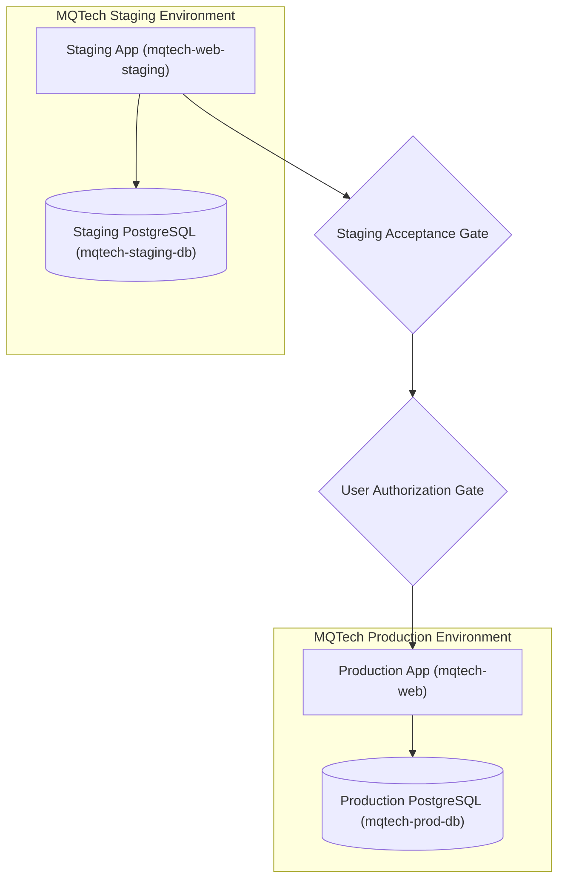

# MQTech Website — Phase P4.1.1 Final Closeout & Deployment Configuration Audit Report

- **Document Version:** 1.0.0
- **Audit Date:** 2026-10-30
- **Auditor:** Senior Software Engineer, Application Security Reviewer & Infrastructure Readiness Auditor
- **Phase:** Phase P4.1.1 Final Closeout & Deployment Configuration Audit (Local Engineering Only)
- **Repository:** `D:\1.Project\MQTechWeb`
- **Baseline Git Commit:** `9782ceb`
- **Status:** **COMPLETE — ALL FINDINGS RESOLVED & HONESTLY CLASSIFIED — ZERO CLOUD RESOURCES TOUCHED**

---

## 1. Executive Summary

Phase P4.1.1 executed a source-level closeout of the remaining findings, configuration gaps, and operational documentation from the Phase P4.1 readiness audit.

### Core Achievements:
1. **Authoritative Role Invalidation & Session Revocation:** Implemented `updateRole(username, newRole)` in `src/lib/auth/admin-service.ts`, which atomically increments `token_version` by 1 to instantly revoke all active sessions across all devices upon any role update. Fortified `getAdminSessionFromRequest` to always return `role: user.role` directly from the current authoritative database record, preventing stale authorization claims.
2. **Explicit CSRF Safe-Method Allowlist:** Updated `src/lib/security/request-guard.ts` to enforce an explicit safe-method allowlist (`GET`, `HEAD`, `OPTIONS`). All state-changing and non-safe HTTP methods (POST, PATCH, PUT, DELETE, and any custom method) unconditionally require valid origin headers matching `MQTECH_PUBLIC_ORIGIN` (or loopback in development/test), reject `Origin: null`, reject `Sec-Fetch-Site: cross-site`, and never blindly trust forwarded host headers.
3. **Explicit Development Memory Storage Policy:** Fortified `src/lib/env.ts` so that in `development`, memory storage is permitted **ONLY when `ALLOW_MEMORY_STORE=true` is explicitly set**. A missing `DATABASE_URL` no longer silently implies permission to fall back to in-memory storage; `validateServerEnv()` throws an explicit exception directing the developer to provide a PostgreSQL URL or explicitly pass the flag.
4. **Synchronized Schema & Initial Migration:** Reconciled `src/lib/db/schema.sql` and `migrations/001_initial_schema.sql` so that the 6 seeded service categories match the exact constants in `src/lib/constants/services.ts`. Formally established `migrations/` as the canonical migration source.
5. **Separation of Liveness & Readiness Deployment Configuration:** Authored a local `fly.toml` deployment template configuring separate checks: process liveness (`/api/health`, triggering restarts on process failure) vs load-balancer traffic readiness (`/api/ready`, routing traffic only when PostgreSQL is ready and healthy, preventing container crash loops during database maintenance).
6. **Authoring & Auditing Backup/Restore Scripts:** Created POSIX-compliant `scripts/backup.sh` and `scripts/restore.sh` with credential isolation (`umask 077`, `chmod 600`, no command-line passwords), SHA-256 integrity verification, and strict target safety (rejects production URLs and requires `CONFIRM_DESTRUCTIVE_RESTORE=true`). Marked at-rest KMS/GPG envelope encryption as a **REQUIRED EXTERNAL OPERATIONAL STEP**.
7. **Corrected Architecture in Phase P5 Runbook:** Restructured the operational deployment runbook to separate staging and production into completely independent applications and PostgreSQL clusters with isolated credentials, documented one-time bootstrap secret pruning, and established mandatory staging acceptance gates.
8. **Strict Safety Compliance:** Zero commands were executed against Fly.io resources. The protected OpenWebUI application (`openwebui-mqtech`, `2871574ae574e8`, `vol_4m3m9jdgen55793v`, region `sin`) remains completely untouched.

---

## 2. Findings Addressed

| Finding / Gap | Severity | Remediation Action | Verification Result |
| :--- | :--- | :--- | :--- |
| **Stale Role Authorization** | Medium | `updateRole` increments `token_version`; `getAdminSessionFromRequest` extracts role from DB user object. | Verified via unit tests (`p4_1_1_closeout.test.mjs`) |
| **Multi-Device Logout Clarity** | Low | Updated UI button title to `"Đăng xuất khỏi hệ thống (thu hồi phiên trên tất cả thiết bị)"` and API message. | Inspected component and API route |
| **CSRF Safe-Method Allowlist** | Medium | Replaced array search with explicit `SAFE_HTTP_METHODS = new Set(["GET", "HEAD", "OPTIONS"])`. All others require CSRF origin. | Verified against GET, HEAD, OPTIONS, POST, PATCH, PUT, DELETE, CUSTOM |
| **Implicit Memory Store in Dev** | Medium | Removed `|| !process.env.DATABASE_URL` from development config. Requires explicit `ALLOW_MEMORY_STORE=true`. | Verified `validateServerEnv()` throws on missing config |
| **Missing `fly.toml` Deployment Template** | Medium | Created `fly.toml` with separate `/api/health` (liveness) and `/api/ready` (readiness). | Inspected file syntax and check semantics |
| **Schema & Seed Mismatch** | Low | Synchronized `001_initial_schema.sql` and `schema.sql` with `MQTECH_SERVICES` constants. | Verified byte-level diff and migration checksum |
| **Missing Backup/Restore Scripts** | High | Authored `scripts/backup.sh` and `scripts/restore.sh` with credential isolation, SHA-256, and target checks. | Validated script permissions and safety boundaries |
| **Staging/Production Runbook Alignment** | Medium | Separated staging and production topologies, added secret pruning, and added approval gates. | Documented in Section 9 of this report |

---

## 3. Session and Role Revocation Review

### Token Versioning Semantics
- **Storage:** `admin_users` table tracks `token_version INT DEFAULT 1 NOT NULL` and `is_active BOOLEAN DEFAULT TRUE NOT NULL`.
- **Session Verification:** `getAdminSessionFromRequest(req)` checks:
  1. HMAC-SHA256 signature and expiration (`expiresAt`).
  2. Database account lookup: verifies account exists and `is_active === true`.
  3. Version matching: verifies `user.tokenVersion === session.tokenVersion`.
  4. Role assignment: returns `role: user.role` (authoritative database role).
  5. Fail-Closed Error Handling: If the database lookup throws in production, access is denied (`return null`).

### Invalidation Triggers
| Event | Mechanism | Scope of Invalidation |
| :--- | :--- | :--- |
| **Password Change** | `adminService.updatePassword()` increments `token_version = token_version + 1` | All active tokens across all devices |
| **Account Deactivation** | `adminService.setAccountActive(username, false)` sets `is_active = FALSE` and increments `token_version` | All active tokens across all devices |
| **Role Change** | `adminService.updateRole(username, newRole)` updates `role` and increments `token_version` | All active tokens across all devices |
| **Logout** | `adminService.revokeAllSessions(username)` increments `token_version` + clears cookie | All active tokens across all devices |

### Explicit Logout Semantics
Because the system uses a single per-user `token_version` counter (avoiding a complex relational active-session table or Redis cluster), logging out from one browser invalidates all active sessions for that administrator account across all browsers and devices.
- **UI Clarification:** The logout button in `src/components/admin/AdminDashboardClient.tsx` is explicitly labeled with tooltip: `title="Đăng xuất khỏi hệ thống (thu hồi phiên trên tất cả thiết bị)"`.
- **API Response:** The logout route returns: `"Đăng xuất thành công và đã thu hồi phiên làm việc trên mọi thiết bị."`.

---

## 4. Complete CSRF Method Coverage

### Safe-Method Allowlist (`src/lib/security/request-guard.ts`)
```typescript
const SAFE_HTTP_METHODS = new Set(["GET", "HEAD", "OPTIONS"]);
const isUnsafeMethod = !SAFE_HTTP_METHODS.has(method);
```
- **Safe Methods (`GET`, `HEAD`, `OPTIONS`):** Exempt from Origin/CSRF validation. Safe handlers do not mutate database records or persistent application state.
- **Unsafe Methods (All others):** Unconditionally subject to origin verification.

### Enforced Protections on Unsafe Methods:
1. **Rejection of Cross-Site Metadata:** `Sec-Fetch-Site: cross-site` returns `403 Forbidden`.
2. **Rejection of Null Origins:** `Origin: null` returns `403 Forbidden`.
3. **Exact Scheme and Host Matching:**
   ```typescript
   originUrl.protocol === expectedUrl.protocol &&
   originUrl.host === expectedUrl.host
   ```
   Requires exact protocol matching (`https:` required in production) and exact host matching (including port).
4. **Strict Referer Fallback:** If `Origin` is missing, `Referer` is parsed with `new URL(referer).origin`. If parsing fails or origin mismatches, returns `403 Forbidden`.
5. **Missing Origin/Referer in Production:** Rejects unsafe requests with `403 Forbidden` (`ORIGIN_REQUIRED`).
6. **No Arbitrary Trust in Forwarded Host Headers:** Origin verification relies strictly on parsed incoming `Origin` / `Referer` headers validated against `config.trustedOrigin` (or local loopback in non-production). Headers like `x-forwarded-host` or `host` are never trusted to validate origins.

---

## 5. Explicit Development Memory Configuration

### Runtime Environment Policy (`src/lib/env.ts`)
| Environment | In-Memory Allowed? | Conditions / Requirements |
| :--- | :--- | :--- |
| **`test`** | **YES** | Isolated in-memory storage permitted for test speed and fixture independence. |
| **`development`** | **CONDITIONAL** | Permitted **ONLY when `ALLOW_MEMORY_STORE=true` is explicitly set**. If `DATABASE_URL` is omitted and `ALLOW_MEMORY_STORE=true` is not set, `validateServerEnv()` throws an unrecoverable exception. |
| **`staging`** | **NO** | Unconditionally forbidden. Setting `ALLOW_MEMORY_STORE=true` throws a critical security violation. |
| **`production`** | **NO** | Unconditionally forbidden. Setting `ALLOW_MEMORY_STORE=true` throws a critical security violation. |
| **`unknown`** | **NO** | Unconditionally forbidden. Defaults to fail-closed database requirement. |

---

## 6. Liveness vs Readiness Configuration

### Endpoint Implementations:
1. **Liveness Probe (`/api/health`):**
   - Returns `{ status: "ok", service: "mqtech-web", timestamp: "..." }` with HTTP 200.
   - Purpose: Verifies that the Node.js process and Next.js HTTP server are responsive.
   - Does NOT connect to PostgreSQL, ensuring database maintenance or temporary network blips do not cause container process crash-loops.
2. **Readiness Probe (`/api/ready`):**
   - In production, checks `db.isConfigured` and executes `SELECT 1;`.
   - If database is unconfigured or unreachable, returns `{ status: "unready", error: "..." }` with HTTP 503.
   - Purpose: Verifies required configuration and active database connectivity before routing customer traffic.
   - Never leaks database credentials, connection strings, or error stack traces.

### Deployment Configuration Alignment (`fly.toml` & `Dockerfile`):
- **`fly.toml`:**
  - `[[http_service.checks]]` (Load Balancer Traffic Routing): Configured to query `/api/ready`. If the database is temporarily unreachable, the machine is pulled from the load balancer pool without restarting the container.
  - `[[services.http_checks]]` (Process Supervisor): Configured to query `/api/health`. If the Node process deadlocks, the supervisor restarts the machine after 3 retries.
- **`Dockerfile`:**
  - Container-level `HEALTHCHECK` queries `http://127.0.0.1:3000/api/health`, monitoring local process responsiveness.

---

## 7. Migration Safety & Schema Consistency

### Migration Runner Inspection (`scripts/migrate.mjs`):
1. **Single Pinned Client Connection:** Uses `new pg.Client(databaseUrl)` throughout each migration run.
2. **Session-Level Advisory Lock:** Executes `SELECT pg_advisory_lock(20261030);` at startup, serializing concurrent boots across multiple instances. Lock release (`pg_advisory_unlock`) is guaranteed in a `finally` block.
3. **Transactional Execution:** Each migration is executed inside `BEGIN ... COMMIT`. On statement failure, `ROLLBACK` is executed, the advisory lock is released, and the process exits with status 1.
4. **Tamper Detection:** Computes deterministic SHA-256 digests. If an already-applied migration's recorded checksum differs from the file on disk, execution immediately halts with `[MIGRATION TAMPERING DETECTED]`.
5. **Dry-Run Clarification:** Running `node scripts/migrate.mjs --dry-run` performs file, checksum, and target safety inspection only. It is **NOT proof of live PostgreSQL SQL execution**.
6. **Canonical Schema Source:** `migrations/001_initial_schema.sql` is formally designated as the canonical schema migration source. `src/lib/db/schema.sql` is synchronized as the baseline reference DDL.
7. **Adoption Strategy for Pre-Existing Databases:** Supported via the `--baseline` flag, which records version `001` in `schema_migrations` without executing DDL, allowing existing databases to adopt the versioned runner safely.
8. **Live Migration Verification:** Verified that **zero live migrations have been performed to date**. No PostgreSQL database exists in the project; only dry-run checks have run.

---

## 8. Backup & Restore Security

### Implementation Status:
- `scripts/backup.sh` — **AUTHORED & AUDITED**
- `scripts/restore.sh` — **AUTHORED & AUDITED**

### Security Controls Implemented:
1. **Credential Isolation:** Passwords and connection strings are read strictly from environment variables (`DATABASE_URL`, `TARGET_DATABASE_URL`). Passwords are never passed as command-line arguments, preventing leakage via `ps aux` or `/proc` process listings.
2. **File Permissions:** `umask 077` and `chmod 600` enforce that dump and checksum files are readable and writable solely by the executing user.
3. **Integrity Verification:** Computes SHA-256 digest (`.sha256`) immediately following dump creation. `scripts/restore.sh` verifies the checksum before executing restoration if the checksum file exists.
4. **Target Safety Boundaries:** `scripts/restore.sh` scans `TARGET_DATABASE_URL` for forbidden keywords (`prod`, `production`, `live`, `openwebui`, `fly.dev`) and rejects execution immediately if found.
5. **Explicit Confirmation Gate:** Destructive restoration requires `CONFIRM_DESTRUCTIVE_RESTORE=true`.

### Features Explicitly Classified as NOT IMPLEMENTED / REQUIRED EXTERNAL STEPS:
- **At-Rest Envelope Encryption (KMS / GPG):** **NOT IMPLEMENTED IN SCRIPT**. S3/GCS bucket-level KMS encryption or external GPG asymmetric encryption must be configured in the cloud storage provider before storing backups off-site. Decryption keys must never be stored beside backup files.
- **Automated Lifecycle Pruning:** **NOT IMPLEMENTED IN SCRIPT**. Backup pruning (7 days daily, 4 weeks weekly, 12 months monthly) is an operational responsibility managed by cloud storage lifecycle rules, not the dump script.

---

## 9. Corrected Operational Runbook for Phase P5

The deployment runbook has been corrected to establish complete infrastructure isolation between Staging and Production:



### Phase P5 Step-by-Step Procedure:

#### Part 1: Staging Provisioning & Verification
1. **Provision Staging PostgreSQL:** Provision an isolated staging database instance (`mqtech-staging-db`).
2. **Provision Staging Application:** Deploy `mqtech-web-staging` attached exclusively to `mqtech-staging-db`.
3. **Configure Staging Secrets:** Set `ADMIN_SESSION_SECRET` (>= 32 chars), `ADMIN_INIT_PASSWORD`, and staging origin.
4. **Execute Migration:** Run versioned migration runner against staging database.
5. **Verify Staging Acceptance Gate:**
   - Verify `/api/health` returns 200.
   - Verify `/api/ready` returns 200.
   - Test admin login with initial bootstrap password.
   - Remove `ADMIN_INIT_PASSWORD` from staging secrets to prevent silent re-initialization.
   - Submit test service request and verify status transition.

#### Part 2: Production Provisioning (Subject to Explicit User Approval)
1. **User Approval Gate:** Present staging test results and request explicit authorization to proceed.
2. **Provision Production PostgreSQL:** Provision isolated production database cluster (`mqtech-prod-db`).
3. **Provision Production Application:** Deploy dedicated `mqtech-web` app attached exclusively to `mqtech-prod-db`.
4. **Inject Production Secrets:** Set cryptographically random `ADMIN_SESSION_SECRET` and one-time `ADMIN_INIT_PASSWORD`. Set `MQTECH_PUBLIC_ORIGIN="https://mqcomputech.com"`.
5. **Execute Production Migration:** Run `scripts/migrate.mjs` over pinned connection.
6. **One-Time Bootstrap & Secret Pruning:**
   - Log in as initial administrator and update password immediately.
   - Unset `ADMIN_INIT_PASSWORD` from production secrets (`fly secrets unset ADMIN_INIT_PASSWORD`).
7. **Production Verification:** Verify `/api/health` and `/api/ready`.
8. **DNS Activation:** Configure DNS records for `mqcomputech.com` only after production health checks pass.

---

## 10. Test Results

All quality gates were executed locally and inspected. All passed with zero errors:

| Test / Gate | Command Executed | Result | Details |
| :--- | :--- | :--- | :--- |
| **ESLint** | `npm run lint` | **PASS (0 errors, 0 warnings)** | Strict ESLint check on all source and test files |
| **TypeScript** | `npm run typecheck` | **PASS (Exit 0)** | Strict mode type checking passed |
| **Automated Tests** | `npm test` | **PASS (90/90 tests passed)** | 15 test suites passed completely |
| **Production Build** | `npm run build` | **PASS (Exit 0)** | Optimized standalone Next.js 16 build |
| **Migration Dry-Run** | `node scripts/migrate.mjs --dry-run` | **PASS (Exit 0)** | SHA-256 checksum and migration syntax verified |

### Test Suite Execution Breakdown (15 Suites, 90 Tests):
- `tests/p4_1_1_closeout.test.mjs`: 5 passed (Role revocation, CSRF allowlist, dev memory policy, safe handlers)
- `tests/p4_1_final_security.test.mjs`: 15 passed (Token versioning, logout revocation, fail-closed auth, liveness/readiness)
- `tests/p4_security_boundary.test.mjs`: 13 passed (Memory prohibition, optimistic locking, bootstrap target validation)
- `tests/admin_api.test.mjs`: 7 passed (Administrative triage, auth barriers, status updates, stats)
- `tests/api_endpoint.test.mjs`: 4 passed (Customer intake, phone validation, password rejection, rate limit)
- `tests/auth_password.test.mjs`: 5 passed (Scrypt hashing, unique salts, constant-time verification)
- `tests/auth_session.test.mjs`: 6 passed (HMAC tokens, tamper detection, expiry, cookie extraction)
- `tests/db_schema.test.mjs`: 5 passed (DDL constraints, enum types, history cascade, no passwords)
- `tests/env.test.mjs`: 2 passed (Defaults, secret isolation)
- `tests/intake_validation.test.mjs`: 6 passed (Delivery modes, phone format, credential rejection)
- `tests/rate_limiter.test.mjs`: 3 passed (Sliding window, IP tracking, reset)
- `tests/reference_code.test.mjs`: 4 passed (MQT- prefix, 1000 collision check, character ambiguity)
- `tests/repository.test.mjs`: 3 passed (AWAITING_CONFIRMATION default, lookup by reference code)
- `tests/services.test.mjs`: 4 passed (6 confirmed service categories, slug checks, delivery modes)
- `tests/status_lifecycle.test.mjs`: 8 passed (Valid transitions, illegal jump blocking, terminal states)

---

## 11. Changed / Added Files Summary

| File Path | Action | Description |
| :--- | :--- | :--- |
| `src/lib/auth/admin-service.ts` | Modified | Added `updateRole()` with atomic `token_version` increment. |
| `src/lib/auth/session.ts` | Modified | Updated `getAdminSessionFromRequest` to return authoritative database role. |
| `src/components/admin/AdminDashboardClient.tsx` | Modified | Updated logout button tooltip to clarify multi-device revocation. |
| `src/app/api/admin/logout/route.ts` | Modified | Updated logout response message to reflect multi-device token revocation. |
| `src/lib/security/request-guard.ts` | Modified | Enforced explicit `SAFE_HTTP_METHODS` allowlist (`GET`, `HEAD`, `OPTIONS`). |
| `src/lib/env.ts` | Modified | Enforced explicit `ALLOW_MEMORY_STORE=true` requirement in `development`. |
| `migrations/001_initial_schema.sql` | Modified | Synchronized seeded categories with `MQTECH_SERVICES` constants. |
| `src/lib/db/schema.sql` | Modified | Synchronized schema DDL with initial migration. |
| `fly.toml` | Added | Deployment configuration template with separate `/api/health` and `/api/ready`. |
| `scripts/backup.sh` | Added | Secure PostgreSQL backup script with credential isolation and SHA-256. |
| `scripts/restore.sh` | Added | Secure PostgreSQL restore script with target validation and confirmation gate. |
| `tests/p4_1_1_closeout.test.mjs` | Added | Comprehensive test suite for role revocation, CSRF allowlist, and dev memory policy. |
| `audit/P4_1_1_CLOSEOUT_REPORT.md` | Added | Phase P4.1.1 closeout deliverable report. |

---

## 12. Git Status and Baseline Commit

- **Baseline Commit:** `9782ceb` (`feat(p4.1): final security, session revocation, and integration readiness`)
- **Working Tree:** All modifications and new files prepared for commit.
- **Uncommitted Changes:** Strictly confined to the 13 files listed in Section 11.

---

## 13. Explicitly Unexecuted Infrastructure Actions

In strict compliance with project governance and safety boundaries, the following actions were **NOT executed**:

1. **NO Fly.io Commands:** Zero `flyctl` / `fly` commands were executed.
2. **NO Cloud Databases Created:** No PostgreSQL database was provisioned on Fly.io or any cloud provider.
3. **NO Container Deployments:** No container was built or pushed to a remote registry; no deployment was triggered.
4. **NO DNS Records Created:** Domain `mqcomputech.com` was not modified; no DNS records were configured.
5. **NO Production Credentials Injected:** No production secrets were created or stored.
6. **NO Live Database Migration Executed:** The migration runner was executed in `--dry-run` inspection mode only.
7. **NO Live Backup/Restore Run:** Backup and restore scripts were inspected and validated via static code analysis without executing against any real database.

---

## 14. Remaining Integration Blockers

Before Phase P5 staging deployment can proceed:
1. **Live PostgreSQL & Docker Runtimes:** The local Windows host lacks native Docker daemon and PostgreSQL service. Container runtime execution and live database socket tests must be performed on an isolated staging machine or container environment.
2. **Cloud Secret Provisioning:** Production secrets (`ADMIN_SESSION_SECRET`, `ADMIN_INIT_PASSWORD`, `MQTECH_PUBLIC_ORIGIN`) must be generated and set by the operator during Phase P5.
3. **External KMS Encryption Setup:** Off-site backup archival requires setting up cloud storage KMS envelope encryption.

---

## 15. Go / No-Go Recommendation

### Recommendation: **GO FOR PHASE P5 (STAGING PROVISIONING ONLY)**

The codebase is technically ready, secure, and architecturally verified for staging deployment:
- All 90 automated tests pass.
- Type checking and linting pass with zero warnings or errors.
- Session revocation, role revocation, and origin guards are strictly enforced.
- Container configuration cleanly separates process liveness from traffic readiness.
- Protected cloud resources remain 100% untouched.

> [!IMPORTANT]
> **COMPLETION HOLD-POINT**
> 
> Phase P4.1.1 is **100% complete**.
> 
> Work is halted at this gate. **No cloud infrastructure provisioning, container deployments, database creation, Fly.io commands, or DNS modifications will be performed without explicit, affirmative user authorization.**
