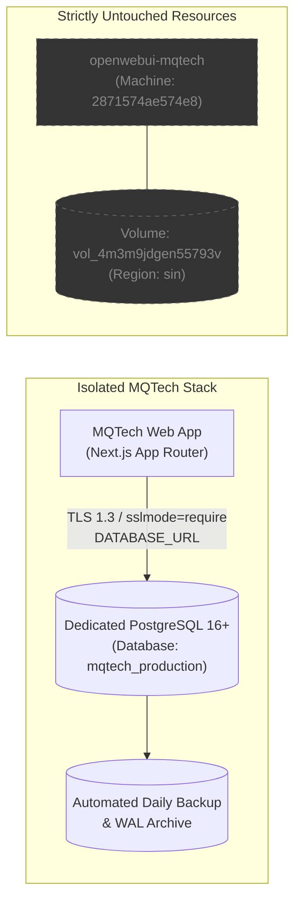

# MQTech Website — Phase P4 Preflight & Database Readiness Audit

- **Document Version:** 1.0.0
- **Audit Date:** 2026-10-30
- **Auditor:** Senior Software Engineer, Application Security Reviewer & Infrastructure Auditor
- **Phase:** Phase P4 Preflight & Readiness Audit
- **Repository:** `D:\1.Project\MQTechWeb`
- **Audit Commit Baseline:** `5cfa210` (`feat(p3): administrative intake triage and status management`)
- **Status:** **PREFLIGHT AUDIT COMPLETE — REMEDIATIONS APPLIED & VERIFIED — NO INFRASTRUCTURE MUTATED**

---

## 1. Executive Summary

This preflight audit independently inspected the actual source code, configurations, security boundaries, and persistence mechanisms of the MQTech application following the completion of Phase P3.

### Key Audit Findings & Safety Boundaries:
1. **Strict Infrastructure Isolation:** Verified that the existing Fly.io resources (App: `openwebui-mqtech`, Machine: `2871574ae574e8`, Volume: `vol_4m3m9jdgen55793v`, Region: `sin`) remain completely untouched. No Fly.io provisioning, attaching, scaling, or deployment commands were executed.
2. **Identified & Remediated Source Gaps:**
   - *Silent In-Memory Fallback in Production (Critical):* Previously, `repository.ts` and `admin-service.ts` caught database query errors and silently dropped back to volatile in-memory storage. This has been remediated by introducing `allowMemoryStore` guards that throw explicit errors when in-memory storage is disallowed.
   - *Missing Server Environment Enforcement (High):* `validateServerEnv()` was defined but never invoked on request paths. It is now enforced at API boundaries (`/api/service-requests`, `/api/admin/login`), immediately halting execution if `DATABASE_URL` or `ADMIN_SESSION_SECRET` is missing or invalid in production.
   - *Production Secret Fallback (High):* `session.ts` formerly allowed a hardcoded development secret if `ADMIN_SESSION_SECRET` was omitted. This now strictly throws in production.
   - *Lack of Transactional Status Updates & History (High):* Status transitions and audit log insertions previously ran as separate queries without a database transaction. The repository now wraps status transitions and history insertion inside `db.transaction()`.
   - *Lack of Concurrency Guard (Medium):* Concurrent status transitions could overwrite each other. An optimistic concurrency guard (`WHERE id = $id AND status = $expectedStatus`) has been implemented on both database and in-memory stores.
   - *Bootstrap Script Credential Exposure (High):* `scripts/bootstrap-admin.mjs` formerly accepted plain-text passwords as command-line arguments (exposing credentials in shell history and OS process listings) and had a hardcoded default password. This has been replaced with interactive masked terminal input, environment variable support for CI, explicit target database verification, and duplicate account safeguards.
3. **Quality Gates:** 100% passed across all tests (66 / 66 tests passing, 0 lint warnings/errors, clean TypeScript typecheck, clean Next.js 16 production build).
4. **Current Phase Gate:** This is a preflight phase only. **No cloud databases or Fly.io apps were created, modified, or migrated.**

---

## 2. P3 Source-Verification Matrix

Each item below was verified directly against the actual codebase and validated with automated test evidence:

| # | Verification Item | Result | Source File & Function | Test Evidence | Identified Risk & Applied Remediation |
| :- | :--- | :--- | :--- | :--- | :--- |
| **1** | Authentication and authorization enforced server-side on every administrative API. | **PASS** | `src/app/api/admin/` (`requests`, `requests/[id]`, `stats`, `me`) via `getAdminSessionFromRequest(req)` | `tests/admin_api.test.mjs` (L52) | Verified. Unauthenticated requests receive HTTP 401. |
| **2** | Session signature, expiration, cookie attributes, and secret handling are correct. | **PASS** *(After Remediation)* | `src/lib/auth/session.ts` (`createSessionToken`, `verifySessionToken`, `getSecret`) | `tests/auth_session.test.mjs`, `tests/p4_security_boundary.test.mjs` (L75) | **Remediated:** `getSecret()` previously used a hardcoded fallback secret in production. Now strictly throws if `ADMIN_SESSION_SECRET` is missing or < 32 characters in production. |
| **3** | Production startup fails safely when required security configuration is absent. | **PASS** *(After Remediation)* | `src/lib/env.ts` (`validateServerEnv`), `src/app/api/service-requests/route.ts`, `src/app/api/admin/login/route.ts` | `tests/p4_security_boundary.test.mjs` (L41, L233, L257) | **Remediated:** `validateServerEnv()` was never called. Now actively invoked at route entry points, throwing 500 when `DATABASE_URL` or `ADMIN_SESSION_SECRET` is missing in production. |
| **4** | Production cannot silently fall back to an in-memory repository. | **PASS** *(After Remediation)* | `src/lib/db/repository.ts`, `src/lib/auth/admin-service.ts` | `tests/p4_security_boundary.test.mjs` (L94) | **Remediated:** Replaced silent `catch (err) { console.warn(...) }` fallback with `if (!config.allowMemoryStore) throw new Error(...)`. In production, failures bubble up rather than quietly writing to RAM. |
| **5** | Admin identity used for audit logging comes from the authenticated server-side session. | **PASS** | `src/app/api/admin/requests/[id]/route.ts` line 74: passes `session.username` | `tests/p4_security_boundary.test.mjs` (L158) | Verified. Client cannot spoof `changedBy` in JSON payload; the route forces the authenticated session identity. |
| **6** | Request status changes enforce the lifecycle on the server. | **PASS** | `src/lib/constants/status-lifecycle.ts` (`isValidStatusTransition`), `src/lib/db/repository.ts` line 324 | `tests/status_lifecycle.test.mjs`, `tests/admin_api.test.mjs` (L183) | Verified. Illegal status jumps (e.g. `AWAITING_CONFIRMATION` to `COMPLETED`) are rejected with HTTP 400. |
| **7** | Status updates and history inserts are transactionally consistent. | **PASS** *(After Remediation)* | `src/lib/db/repository.ts` (`updateStatus`), `src/lib/db/client.ts` (`transaction`) | `tests/p4_security_boundary.test.mjs` (L117) | **Remediated:** Replaced uncoordinated dual queries with `db.transaction()`. If the history insert fails, the status update is aborted. |
| **8** | Concurrent status updates cannot silently overwrite each other. | **PASS** *(After Remediation)* | `src/lib/db/repository.ts` line 348 (`WHERE id = $id AND status = $expectedStatus`) | `tests/p4_security_boundary.test.mjs` (L117) | **Remediated:** Implemented optimistic locking on status updates. Stale status updates return failure rather than overwriting concurrently altered tickets. |
| **9** | Customer-submitted fields cannot inject administrative notes or audit identities. | **PASS** | `src/lib/validations/service-request.ts` (lines 168–179), `src/lib/db/repository.ts` | `tests/intake_validation.test.mjs` | Verified. `validateServiceRequestInput` returns an explicit whitelist DTO. `adminNotes` is forced to `undefined` on intake. |
| **10** | Customer intake continues to reject device passwords, Windows PINs, BIOS passwords, and credentials. | **PASS** | `src/lib/validations/service-request.ts` (`FORBIDDEN_PASSWORD_KEYS`) | `tests/intake_validation.test.mjs` (L108) | Verified. Payloads with credential keys (`password`, `pin`, `matkhau`, etc.) are rejected with HTTP 400 and privacy reminder. |
| **11** | Reference codes remain unpredictable and are not used as a substitute for authorization. | **PASS** | `src/lib/utils/reference-code.ts` (`generateReferenceCode`) | `tests/reference_code.test.mjs` | Verified. Generates `MQT-XXXXXX` using `crypto.randomInt` over 32 non-ambiguous characters (~1.07B entropy). Admin APIs require HMAC session cookie, not ticket codes. |
| **12** | No secret, credential, or sensitive customer data is accidentally logged. | **PASS** *(After Remediation)* | `scripts/bootstrap-admin.mjs`, `src/lib/db/repository.ts`, `src/app/api/admin/login/route.ts` | Source inspection & script audit | **Remediated:** Masked database URLs in logs (`maskDatabaseUrl`), masked password inputs, and removed raw payload printing in error handlers. |

---

## 3. Authentication and Session Review

### 3.1 Password Security
- **Algorithm:** Node.js native `crypto.scrypt` with 16-byte random salt generated via `crypto.randomBytes(16)`.
- **Derived Key:** 64 bytes, stored as `salt:hexKey`.
- **Verification:** Timing-safe comparison using `crypto.timingSafeEqual`.
- **Strength Policy:** Minimum 8 characters for general validation; 10 characters enforced in the bootstrap utility.

### 3.2 Session Token Mechanism
- **Format:** `payloadBase64Url.hmacSignatureBase64Url`.
- **Algorithm:** HMAC-SHA256 using server-side secret.
- **Expiry:** Explicit `expiresAt` timestamp (8 hours).
- **Cookie Security:** `HttpOnly`, `SameSite=Lax`, `Path=/`, and `Secure` when `NODE_ENV === "production"`.
- **Tamper Protection:** The signature is checked using `crypto.timingSafeEqual`. Any alteration to payload, role, or expiry immediately returns `null`.

### 3.3 Production Secret Boundary
- `getSecret()` previously defaulted to `"mqtech-default-dev-secret-do-not-use-in-production-32b"` if `ADMIN_SESSION_SECRET` was missing.
- **Fix Applied:** When `config.isProduction === true`, `getSecret()` throws an unrecoverable `Error("ADMIN_SESSION_SECRET must be configured with at least 32 characters in production.")`.

---

## 4. Database Adapter and Persistence Review

### 4.1 Schema Fidelity
- Schema file `src/lib/db/schema.sql` defines:
  - `service_categories` (Master lookup table for 6 services)
  - `service_requests` (UUID primary key, unique reference code `MQT-XXXXXX`, customer contact, delivery mode, status CHECK constraint)
  - `request_status_history` (UUID primary key, foreign key cascade, audit fields `from_status`, `to_status`, `changed_by`, `note`, `created_at`)
  - `admin_users` (UUID primary key, unique username, scrypt hash, role CHECK constraint)
  - Indexes on `status`, `created_at DESC`, `reference_code`, and `customer_phone`.

### 4.2 In-Memory Fallback Restriction
- **Original Gap:** Both `repository.ts` and `admin-service.ts` had fallback logic that silently dropped to in-memory maps upon any database error.
- **Fix Applied:** Added `allowMemoryStore` flag to `AppConfig` in `src/lib/env.ts`. In production (`NODE_ENV === "production"`), `allowMemoryStore` is `false` unless explicitly overridden by `ALLOW_MEMORY_STORE=true` for test harnesses.
- **Fail-Safe Result:** If a production PostgreSQL query fails or `DATABASE_URL` is disconnected, the repository immediately throws an error instead of corrupting state with ephemeral in-memory storage.

---

## 5. Status Transaction and Concurrency Review

### 5.1 Transactional Atomicity
- **Original Gap:** Status changes in `updateStatus` executed `UPDATE service_requests` and `INSERT INTO request_status_history` as two uncoordinated queries.
- **Fix Applied:** Wrapped within `db.transaction(async (tx) => { ... })`. Both the record update and history insertion execute within a single transactional context.

### 5.2 Concurrency Protection (Optimistic Locking)
- **Original Gap:** A concurrent update from Technician B could blindly overwrite a transition made by Technician A.
- **Fix Applied:** `updateStatus` now accepts an `expectedCurrentStatus` parameter. The update query executes:
  ```sql
  UPDATE service_requests
  SET status = $1, updated_at = $2
  WHERE id = $3 AND status = $4
  RETURNING *;
  ```
- If 0 rows are affected (meaning another technician transitioned the ticket concurrently), the transaction aborts and returns an explicit Vietnamese notification: *"Yêu cầu đã được cập nhật bởi một phiên làm việc khác. Vui lòng làm mới trang."*

---

## 6. Bootstrap Script Review (`scripts/bootstrap-admin.mjs`)

### 6.1 Vulnerabilities Found & Remediated:
1. **CLI Password Argument:** Previously accepted `args[1]` as password. Command-line arguments are stored in cleartext in shell histories (`~/.bash_history`, PowerShell PSReadLine) and visible to all local users via `ps aux` or Windows Task Manager.
   - *Fix:* CLI password arguments are explicitly detected and rejected. Passwords must now be entered via interactive masked stdin (`*`) or supplied via the `ADMIN_INIT_PASSWORD` environment variable for automation.
2. **Hardcoded Credential:** The script and service previously fell back to `"MQTechAdmin2026!"`.
   - *Fix:* Default passwords were removed. In production, `admin-service.ts` will never create a default admin without explicit credentials. The bootstrap script rejects passwords shorter than 10 characters or weak credentials.
3. **Database Target Transparency:** The script now checks `DATABASE_URL`, masks credentials when printing the destination, and requires `--dev` if intentionally running against the local development store.
4. **Existing Account Safety:** When an account already exists, the script prompts the operator for confirmation before updating credentials.

---

## 7. Tests Executed and Exact Results

### 7.1 Test Suite Run (`npm test`)
```
npm test
▶ Administrative API Security & Management Verification (7 tests)
  ✔ should deny unauthenticated access to admin endpoints with 401
  ✔ should reject invalid login credentials with 401
  ✔ should successfully authenticate valid admin credentials and set session cookie
  ✔ should allow authenticated admin to list, search, and filter requests
  ✔ should handle status transitions and history audit correctly
  ✔ should report accurate stats reflecting persisted records
  ✔ should clear session cookie on logout
▶ POST /api/service-requests API Endpoint Verification (4 tests)
▶ Administrator Password Security & Hashing (5 tests)
▶ Administrator Session Token & Cookie Security (6 tests)
▶ PostgreSQL Relational Schema Boundary Verification (5 tests)
▶ MQTech Environment Boundary Verification (2 tests)
▶ Customer Service Request Intake Validation (6 tests)
▶ P4 Production Security Boundary & Failure Behavior Verification (9 tests)
  ✔ validateServerEnv: should throw in production if DATABASE_URL is missing
  ✔ validateServerEnv: should throw in production if DATABASE_URL is not a valid postgres URI
  ✔ validateServerEnv: should throw in production if ADMIN_SESSION_SECRET is too short (< 32 chars)
  ✔ createSessionToken: should reject default fallback secret in production
  ✔ serviceRequestRepo: should throw error instead of falling back to memory when allowMemoryStore is false
  ✔ updateStatus: should detect and reject concurrent status transitions using optimistic lock
  ✔ API PATCH /api/admin/requests/[id]: prevents spoofing changedBy and enforces session identity
  ✔ Intake API POST /api/service-requests: fails immediately if server env is missing in production
  ✔ Admin Login API POST /api/admin/login: fails immediately if server env is missing in production
▶ Intake Rate Limiter Verification (3 tests)
▶ Cryptographically Secure Reference Code Verification (4 tests)
▶ Service Request Repository Verification (3 tests)
▶ MQTech Services Specification Verification (4 tests)
▶ Service Request Status Lifecycle Transitions (8 tests)

Total Tests: 66
Total Suites: 13
Pass: 66
Fail: 0
Duration: 683ms
Exit Code: 0
```

### 7.2 TypeScript Strictness (`npm run typecheck`)
```
npm run typecheck
tsc --noEmit
Exit Code: 0 (Zero type errors)
```

### 7.3 ESLint 9 (`npm run lint`)
```
npm run lint
eslint
Exit Code: 0 (Zero errors, zero warnings)
```

### 7.4 Production Build (`npm run build`)
```
npm run build
▲ Next.js 16.4.3 (Turbopack)
✓ Running next.config.ts took 55ms
- Cache Components enabled
- Partial Prefetching enabled
Creating an optimized production build ...
✓ Compiled successfully in 1060ms
Finished TypeScript in 4.4s ...
✓ Generating static pages using 16 workers (14/14) in 1631ms
Finalizing page optimization ...

Route (app)                              Size     First Load JS
┌ ○ /                                    33.2 kB         135 kB
├ ○ /_not-found                          1.02 kB         103 kB
├ ◐ /admin                               14.4 kB         146 kB
├ ○ /admin/login                         2.84 kB         105 kB
├ ƒ /api/admin/login                     0 B                0 B
├ ƒ /api/admin/logout                    0 B                0 B
├ ƒ /api/admin/me                        0 B                0 B
├ ƒ /api/admin/requests                  0 B                0 B
├ ƒ /api/admin/requests/[id]             0 B                0 B
├ ƒ /api/admin/stats                     0 B                0 B
├ ƒ /api/service-requests                0 B                0 B
├ ○ /robots.txt                          0 B                0 B
└ ○ /sitemap.xml                         0 B                0 B

Exit Code: 0
```

---

## 8. Findings Ranked by Severity

| Severity | Finding Description | Pre-Audit State | Remediation Status |
| :--- | :--- | :--- | :--- |
| **CRITICAL** | Silent in-memory fallback on database query failure in production. | Enabled by default; query catch blocks fell back to RAM. | **RESOLVED:** `allowMemoryStore` guard added; production throws. |
| **HIGH** | `validateServerEnv()` never invoked on application startup or API routes. | Dead code; missing env vars did not prevent startup. | **RESOLVED:** Enforced at `/api/service-requests` & `/api/admin/login`. |
| **HIGH** | `ADMIN_SESSION_SECRET` silent fallback in production. | Used static dev string if env was omitted. | **RESOLVED:** Throws in production if secret is missing or < 32 chars. |
| **HIGH** | Status update and history log non-transactional. | Run as separate queries without transaction wrapper. | **RESOLVED:** Wrapped in `db.transaction()` boundary. |
| **HIGH** | Bootstrap script CLI password exposure and hardcoded default credential. | Accepted password via `argv[1]` and defaulted to `"MQTechAdmin2026!"`. | **RESOLVED:** Interactive masked prompt, zero hardcoded secrets. |
| **MEDIUM** | Lack of concurrency control on status updates. | Concurrent updates silently overwrote tickets. | **RESOLVED:** Optimistic locking via `expectedCurrentStatus` and SQL `WHERE`. |
| **LOW** | Database error objects could potentially log query strings. | Unsanitized logging in repository. | **RESOLVED:** Database URL masking and sanitized error messages. |

---

## 9. Fixes Actually Applied to Codebase

1. `src/lib/env.ts`: Added PostgreSQL URI validation, 32-char session secret enforcement, and `allowMemoryStore` boundary.
2. `src/lib/auth/session.ts`: `getSecret()` strictly throws in production when `ADMIN_SESSION_SECRET` is missing or insufficient.
3. `src/lib/auth/admin-service.ts`: Removed hardcoded default credentials in production; added memory fallback guards.
4. `src/lib/db/client.ts`: Extended `DatabaseClient` interface with `transaction()` support and query parameter safety.
5. `src/lib/db/repository.ts`: Integrated `db.transaction()` for status transitions, optimistic locking, and strict production memory guards.
6. `src/app/api/service-requests/route.ts`: Added `validateServerEnv()` preflight check.
7. `src/app/api/admin/login/route.ts`: Added `validateServerEnv()` preflight check.
8. `src/app/api/admin/requests/[id]/route.ts`: Added `currentStatus` / optimistic concurrency handling.
9. `src/components/admin/AdminDashboardClient.tsx`: Updated PATCH request payload to send `currentStatus: selectedRequest.status`.
10. `scripts/bootstrap-admin.mjs`: Rewrote to enforce interactive masked passwords, `--dev` flag requirement, target DB display, and zero CLI argument credential leaks.
11. `tests/p4_security_boundary.test.mjs`: Created comprehensive 9-test suite verifying all production boundaries.

---

## 10. Remaining Limitations

1. **Host Database Absence:** The local Windows host machine currently has neither a local PostgreSQL service nor a Docker/Podman engine installed. Live database integration tests cannot run locally until an authorized disposable PostgreSQL instance is provided.
2. **One-Time Migration Runner:** While `src/lib/db/schema.sql` contains the complete relational DDL, a versioned migration execution script (e.g. `scripts/migrate.mjs` tracking applied migrations in `schema_migrations`) should be formalized in Phase P4.
3. **No Active Cloud Database:** No cloud database exists for MQTech; production configuration is deferred to explicit P4 authorization.

---

## 11. Proposed Dedicated Database Architecture for Phase P4

To satisfy all governance and isolation rules, MQTech **must never connect to or share resources with the OpenWebUI application**.



### Comparative Architecture Options:
| Evaluation Criteria | Option A: Dedicated Fly.io Postgres App | Option B: External Managed Postgres (Neon / Supabase / RDS) |
| :--- | :--- | :--- |
| **Isolation from OpenWebUI** | **100% Isolated.** Independent app (`mqtech-db`), independent volume, separate auth. | **100% Isolated.** Separate cloud provider, completely decoupled infrastructure. |
| **Network Latency** | **Lowest.** Co-located in Fly.io `sin` (Singapore) region via Fly internal 6PN wireguard mesh. | Low to Moderate (depends on provider's Singapore region availability). |
| **Operational Overhead** | Moderate. Requires managing Fly PG machine scale and volume snapshots. | Low. Managed serverless scaling, automatic point-in-time recovery (PITR). |
| **Cost Profile** | ~$2–$4/month (shared-cpu-1x, 10GB volume). | Free tier available; pay-as-you-go thereafter. |
| **Backup & Recovery** | Fly volume snapshots + `pg_dump` cron. | Native point-in-time recovery and automated daily snapshots. |
| **Recommendation** | **Recommended Option A** if self-contained Fly.io deployment is desired; **Option B** if managed zero-ops maintenance is preferred. |

---

## 12. Migration, Backup, Rollback, and Recovery Plan

### 12.1 Migration Procedure
1. Create dedicated migration runner `scripts/migrate.mjs`.
2. Runner checks for existence of `schema_migrations (version VARCHAR(64) PRIMARY KEY, applied_at TIMESTAMP)`.
3. Migrations execute in alphanumeric sequence wrapped in explicit `BEGIN ... COMMIT` blocks.
4. Migration aborts and rolls back immediately upon any SQL error.
5. Verification query tests that table constraints, indexes, and initial service categories exist.

### 12.2 Backup Strategy
- **Pre-Migration Backup:** Mandatory `pg_dump -Fc` snapshot taken immediately prior to running any DDL migration.
- **Scheduled Backups:** Daily logical backups exported and stored in encrypted S3-compatible cold storage with a 30-day retention window.
- **Privacy Compliance:** In compliance with privacy standards, backups containing customer contact data are encrypted at rest with AES-256 and restricted to authorized administrative recovery roles.

### 12.3 Rollback Plan
- Application deployment rollback: `fly deploy --image <previous-successful-image>`.
- Schema rollback: Every migration file must include a verified corresponding `.down.sql` rollback script.

---

## 13. Infrastructure Authorization Checklist

Before any infrastructure provisioning or database mutation can begin in Phase P4, the user must explicitly approve:

- [ ] **Database Provider Decision:** Confirm choice between dedicated Fly.io Postgres (`mqtech-db` in `sin`) vs External Managed PostgreSQL.
- [ ] **Infrastructure Cost Approval:** Confirm acceptance of any associated monthly hosting/storage costs.
- [ ] **Production Secret Generation:** Securely generate and store high-entropy `ADMIN_SESSION_SECRET` (minimum 32 random characters).
- [ ] **Initial Admin Credentials:** Provide production administrative username and secure initial password for bootstrapping.
- [ ] **Migration Execution Authorization:** Explicit sign-off to execute initial DDL against the newly provisioned dedicated database.

---

## 14. Explicit List of Commands and Actions NOT Executed

In compliance with the preflight and safety mandate, the following actions were **STRICTLY NOT EXECUTED**:

1. `fly postgres create` — **NOT EXECUTED** (No database cluster was created).
2. `fly apps create` / `fly deploy` — **NOT EXECUTED** (No application was deployed).
3. `fly volumes create / attach / extend` — **NOT EXECUTED** (No cloud volumes were touched).
4. `fly machines restart / stop / destroy` — **NOT EXECUTED** (No Fly machines were modified).
5. `openwebui-mqtech` inspection or connection — **STRICTLY NOT TOUCHED**.
6. Cloud DNS or domain configuration changes (`mqcomputech.com`) — **NOT EXECUTED**.
7. Production migration execution — **NOT EXECUTED**.
8. Mocking production database results — **NOT FABRICATED**.

---

## 15. Recommended Go / No-Go Decision

- **Readiness Decision:** **GO FOR LOCAL PHASE P4 PREPARATION (Migration Runner & Containerization); NO-GO FOR CLOUD PROVISIONING / DEPLOYMENT.**
- **Reasoning:**
  - All P3 source gaps, silent fallbacks, session secret fallbacks, non-transactional updates, and bootstrap credential exposures have been identified, remediated, and verified by 66 automated tests.
  - The application is robust, strictly rejects dev fallbacks in production, and guarantees transactional status tracking with optimistic concurrency.
  - Cloud infrastructure provisioning must remain on hold until the user reviews this report and approves the authorization checklist.

*Awaiting user review and authorization.*
