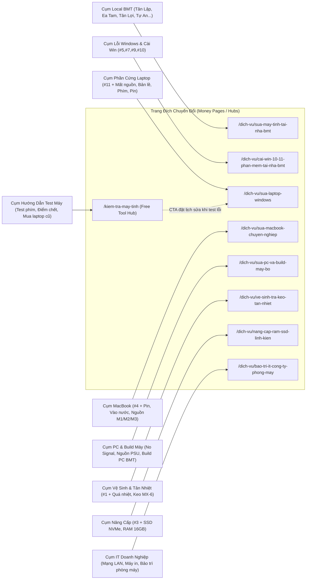

# Kế Hoạch & Lộ Trình Triển Khai SEO Cho Website MQTech (`suamaytinhbmt.id.vn`)

## 1. Mục tiêu & Hiện trạng kiểm định (Audit thực tế)

Mục tiêu của kế hoạch là đưa `suamaytinhbmt.id.vn` lên top Google bền vững ở cả **Local SEO tại TP. Buôn Ma Thuột / Đắk Lắk** (nhóm từ khóa chuyển đổi ra đơn sửa chữa) lẫn **Traffic tự nhiên toàn quốc** (nhóm từ khóa hướng dẫn sửa lỗi & test phần cứng online qua `/kiem-tra-may-tinh`).

### 1.1. Bảng kiểm định 11 bài viết SEO đang có trên Production

| ID | Slug | Chuyên mục | Số từ | H2/H3 | Internal Link | Ảnh Gallery | Đánh giá hiện trạng |
|---:|---|---|---:|---:|---:|---:|---|
| 1 | `5-dau-hieu-laptop-can-ve-sinh-tra-keo-tan-nhiet` | Bảo Dưỡng Phần Cứng | **247** | 5 | **0** | 0 | ⚠️ **Thin Content** + 0 link về `/dich-vu/ve-sinh-tra-keo-tan-nhiet` |
| 2 | `cach-khac-phuc-loi-man-hinh-xanh-bsod-windows-11` | Thủ Thuật Windows | **152** | 3 | **0** | 0 | ⚠️ **Thin Content** + 0 link về dịch vụ cài Win / sửa tại nhà |
| 3 | `nen-nang-cap-ssd-hay-ram-truoc-cho-laptop-cu` | Nâng Cấp Máy | **139** | 2 | **0** | 0 | ⚠️ **Thin Content** + 0 link về `/dich-vu/nang-cap-ram-ssd-linh-kien` |
| 4 | `bi-quyet-bao-ve-pin-macbook-ben-lau` | Cẩm Nang MacBook | **111** | 2 | **0** | 0 | ⚠️ **Thin Content** + 0 link về `/dich-vu/sua-macbook-chuyen-nghiep` |
| 5 | `dich-vu-cai-win-10-11-phan-mem-tai-nha-bmt` | Thủ Thuật Windows | 1.153 | 5 | 1 | 4 | ⚠️ **Trùng intent** với trang dịch vụ `/dich-vu/cai-win-10-11-phan-mem-tai-nha-bmt` |
| 6 | `sua-may-tinh-tai-nha-phuong-tan-lap-tan-an-bmt` | Sửa Chữa Tại Nhà BMT | 737 | 4 | 3 | 2 | ✅ Tốt — cần bổ sung thêm link chéo sang bài lỗi cụ thể |
| 7 | `cai-win-tai-nha-phuong-tan-lap-tan-an-bmt` | Thủ Thuật Windows | 599 | 3 | 2 | 2 | ⚠️ **Dễ ăn thịt từ khóa** với Bài #5 và trang dịch vụ Cài Win |
| 8 | `bang-gia-sua-may-tinh-tai-nha-bmt-tan-lap-tan-an` | Bảng Giá & Tư Vấn | 591 | 4 | 4 | 1 | ✅ Tốt — đã có 4 internal link |
| 9 | `may-loi-sau-cap-nhat-windows-cai-win-tai-nha-tan-lap` | Thủ Thuật Windows | 1.248 | 7 | **0** | 1 | ✅ Nội dung rất tốt — **thiếu hoàn toàn internal link** |
| 10 | `laptop-chay-cham-phai-lam-sao-tan-lap-bmt` | Thủ Thuật Windows | 1.031 | 7 | **0** | 1 | ✅ Nội dung rất tốt — **thiếu hoàn toàn internal link** |
| 11 | `man-hinh-laptop-chop-soc-kien-lam-to-bmt` | Bảo Dưỡng Phần Cứng | 756 | 8 | **0** | 4 | 🌟 **Case Study E-E-A-T xuất sắc** — **thiếu internal link** về `/dich-vu/sua-laptop-windows` & `/dat-lich` |

### 1.2. 4 vấn đề lớn phát hiện từ Audit
1. **4 bài viết seed đầu tiên quá mỏng (111 – 247 từ):** Dưới ngưỡng tối thiểu SEO (800+ từ), dễ bị Google xem là nội dung kém chất lượng (Thin Content) làm giảm uy tín toàn miền.
2. **63.6% bài viết (7/11 bài) có 0 liên kết nội bộ:** Ngay cả 3 bài mới viết rất hay (#9, #10, #11) chưa trỏ link về trang dịch vụ đích (`/dich-vu/...`), bảng giá (`/bang-gia`) hay trang đặt lịch (`/dat-lich`).
3. **Ăn thịt từ khóa (Keyword Cannibalization) ở cụm "Cài Win tại nhà BMT":** Đang có 4 URL cùng nhắm cụm từ khóa này (`/dich-vu/cai-win-...`, Bài #5, Bài #7, Bài #9) nhưng chưa phân vai rõ ràng (trang nào là trang đích chính, bài nào là bài hỗ trợ/local).
4. **Lệch cụm chủ đề & Dịch vụ "mồ côi":**
   - Cụm **Cài Win / Windows** đang chiếm 5/11 bài (~45%).
   - Các dịch vụ biên lợi nhuận cao như **Sửa PC & Build máy bộ** (`0 bài`), **Bảo trì IT công ty/phòng máy** (`0 bài`), **Sửa phần cứng Laptop** (mất nguồn, gãy bản lề, thay pin, liệt phím), **MacBook**, **Nâng cấp SSD/RAM** gần như bị bỏ trống.
   - **Vũ khí SEO `/kiem-tra-may-tinh`** (test bàn phím, màn hình, loa, mic, webcam, benchmark online) hiện có **0 bài viết kéo traffic**.

---

## 2. Kiến trúc Topic Cluster (Hub & Spoke)

---

## 3. Lộ trình triển khai chi tiết từng bước (4 Giai đoạn — 12 Tuần)

### Giai đoạn 1 (Tuần 1): Tối ưu nền tảng SEO kỹ thuật & "Cứu" 11 bài hiện có
> **Mục tiêu:** Sửa triệt để lỗi kỹ thuật & nâng toàn bộ 11 bài sẵn có lên chuẩn SEO trước khi bơm bài mới.

1. **Nâng cấp SEO kỹ thuật trong mã nguồn (Proposed Code Changes ở Mục 4):**
   - Bổ sung `alternates.canonical`, `openGraph` (`type: "article"`, ảnh bìa), `twitter` card cho trang `/bai-viet/[slug]` và `/dich-vu/[slug]`.
   - Nâng cấp JSON-LD `Article` (thêm `mainEntityOfPage`, `publisher.logo`) và `Service` schema.
   - Nâng cấp thuật toán **Bài viết liên quan** trên `/bai-viet/[slug]` (ưu tiên cùng chuyên mục + hiển thị 3 bài thay vì 2 bài ngẫu nhiên).
   - Bổ sung khối **"Kiến thức & Ca sửa liên quan"** trên trang `/dich-vu/[slug]` để tạo vòng liên kết 2 chiều Hub ↔ Spoke.
2. **Viết lại & mở rộng 4 bài seed mỏng (ID #1, #2, #3, #4):**
   - Nâng độ dài mỗi bài lên **900 – 1.200 từ**, cấu trúc H2/H3 rõ ràng, có bảng so sánh / triệu chứng, FAQ cuối bài và **3–5 internal link** trỏ về trang dịch vụ tương ứng.
3. **Bổ sung Internal Link cho 3 bài chất lượng đang có 0 link (ID #9, #10, #11):**
   - Bài #9 (Lỗi Windows Update) → trỏ về `/dich-vu/cai-win-10-11-phan-mem-tai-nha-bmt`, `/bang-gia`, `/dat-lich`.
   - Bài #10 (Laptop chạy chậm) → trỏ về `/dich-vu/nang-cap-ram-ssd-linh-kien`, `/dich-vu/ve-sinh-tra-keo-tan-nhiet`, Bài #3.
   - Bài #11 (Kiến làm tổ màn hình) → trỏ về `/dich-vu/sua-laptop-windows`, `/kiem-tra-may-tinh` (test màn hình), `/dat-lich`.
4. **Phân vai cụm "Cài Win" (chống ăn thịt từ khóa):**
   - `/dich-vu/cai-win-10-11-phan-mem-tai-nha-bmt`: Trang đích chính cho từ khóa thương mại *"cài win tại nhà BMT"*.
   - Bài #5: Điều chỉnh góc độ thành **Cẩm nang chọn phiên bản Win 10/11 & danh sách phần mềm thiết yếu tại BMT**, trỏ anchor link chính về trang dịch vụ.
   - Bài #7: Tập trung sâu vào **Local cụm Tân Lập – Tân An** (tuyến đường Nguyễn Chí Thanh, Võ Thị Sáu, Y Moan, Phan Chu Trinh...), trỏ link về trang dịch vụ.

---

### Giai đoạn 2 (Tuần 2 – Tuần 4): Phủ cụm Money Keywords & 4 dịch vụ đang "mồ côi" (6 bài — 2 bài/tuần)

| Tuần | STT | Tiêu đề đề xuất & Từ khóa chính | Nhóm dịch vụ đích (Hub) | Intent |
|---:|---:|---|---|---|
| Tuần 2 | 1 | **Laptop Không Lên Nguồn, Bật Chỉ Nháy Đèn: 6 Nguyên Nhân & Chi Phí Sửa Tại BMT** (`sửa laptop không lên nguồn BMT`) | `/dich-vu/sua-laptop-windows` | Thương mại / Xử lý lỗi |
| Tuần 2 | 2 | **PC Bật Quạt Quay Nhưng Màn Hình Báo No Signal: Cách Tự Kiểm Tra & Sửa Tại Nhà BMT** (`sửa pc không lên màn hình BMT`) | `/dich-vu/sua-pc-va-build-may-bo` | Xử lý lỗi + Local |
| Tuần 3 | 3 | **Thay Pin Laptop Chính Hãng Tại Buôn Ma Thuột: Dấu Hiệu Pin Chai & Bảng Giá 2026** (`thay pin laptop BMT`) | `/dich-vu/sua-laptop-windows` | Thương mại cao |
| Tuần 3 | 4 | **Sửa Bản Lề Laptop Bị Gãy, Bung Vỏ Lấy Liền Tại BMT — Đừng Để Đứt Cáp Màn Hình!** (`sửa bản lề laptop BMT`) | `/dich-vu/sua-laptop-windows` | Thương mại / Case |
| Tuần 4 | 5 | **Tư Vấn Build PC Văn Phòng, Kế Toán & Gaming Tối Ưu Ngân Sách Tại Buôn Ma Thuột** (`build pc buôn ma thuột`) | `/dich-vu/sua-pc-va-build-may-bo` | Tư vấn mua hàng |
| Tuần 4 | 6 | **Dịch Vụ Bảo Trì IT Văn Phòng, Chia Sẻ Máy In & Mạng LAN Nội Bộ Tại BMT** (`bảo trì it công ty BMT`, `sửa mạng máy in văn phòng BMT`) | `/dich-vu/bao-tri-it-cong-ty-phong-may` | B2B / Doanh nghiệp |

---

### Giai đoạn 3 (Tuần 5 – Tuần 8): Nam châm Traffic từ `/kiem-tra-may-tinh` & Cụm MacBook (6 bài — 1.5 bài/tuần)

| Tuần | STT | Tiêu đề đề xuất & Từ khóa chính | Hub đích | Mục tiêu chiến lược |
|---:|---:|---|---|---|
| Tuần 5 | 7 | **Cách Test Bàn Phím Laptop Online Miễn Phí — Kiểm Tra Phím Liệt, Chập Phím Trong 30 Giây** (`test bàn phím online`, `kiểm tra bàn phím laptop`) | `/kiem-tra-may-tinh` + `/dich-vu/sua-laptop-windows` | Kéo traffic lớn + CTA thay phím |
| Tuần 5 | 8 | **Cách Kiểm Tra Điểm Chết, Hở Sáng & Ám Màu Màn Hình Laptop Online Chuẩn Xác** (`test màn hình online`, `kiểm tra điểm chết màn hình`) | `/kiem-tra-may-tinh` + Bài #11 | Kéo traffic lớn + CTA thay màn |
| Tuần 6 | 9 | **Checklist 10 Bước Kiểm Tra Laptop Cũ Trước Khi Mua (Kèm Công Cụ Test Online Miễn Phí)** (`cách kiểm tra laptop cũ`) | `/kiem-tra-may-tinh` + `/dich-vu/sua-laptop-windows` | Traffic cao, sinh viên ĐH Tây Nguyên |
| Tuần 7 | 10 | **Sửa MacBook Không Lên Nguồn, Không Nhận Sạc Type-C Tại Buôn Ma Thuột** (`sửa macbook bmt`, `sửa nguồn macbook`) | `/dich-vu/sua-macbook-chuyen-nghiep` | Biên lợi nhuận cao |
| Tuần 7 | 11 | **MacBook Bị Đổ Nước, Cà Phê: 5 Việc Phải Làm Ngay Trong 5 Phút Để Cứu Mainboard** (`macbook bị vô nước xử lý sao`) | `/dich-vu/sua-macbook-chuyen-nghiep` | Cứu hộ khẩn cấp / E-E-A-T |
| Tuần 8 | 12 | **Nâng Cấp SSD NVMe & RAM Cho Laptop Tại BMT: Giữ Nguyên 100% Dữ Liệu, Lấy Ngay 30 Phút** (`nâng cấp ssd laptop bmt`, `nâng cấp ram bmt`) | `/dich-vu/nang-cap-ram-ssd-linh-kien` | Chuyển đổi trực tiếp |

---

### Giai đoạn 4 (Tuần 9 – Tuần 12): Phủ Local SEO Đa Phường BMT & Case Study Thực Chiến (6 bài)

| Tuần | STT | Tiêu đề đề xuất & Từ khóa chính | Khu vực / Chủ đề | Giá trị E-E-A-T |
|---:|---:|---|---|---|
| Tuần 9 | 13 | **Sửa Laptop & Cài Win Cho Sinh Viên ĐH Tây Nguyên, Phường Ea Tam BMT — Ưu Đãi Giá Sinh Viên** (`sửa laptop ea tam bmt`, `sửa máy tính gần đh tây nguyên`) | Phường Ea Tam | Tệp sinh viên cực đông |
| Tuần 9 | 14 | **Sửa Máy Tính, Máy In Tận Nơi Phường Tân Lợi & Tự An, Buôn Ma Thuột — Có Mặt 20 Phút** (`sửa máy tính tân lợi bmt`, `sửa máy tính tự an bmt`) | Tân Lợi – Tự An | Khu dân cư & văn phòng lớn |
| Tuần 10 | 15 | **Sửa Chữa & Vệ Sinh Máy Tính Tại Nhà Phường Thành Công, Thắng Lợi, Tân Tiến BMT** (`sửa máy tính thành công bmt`) | Trung tâm BMT | Phủ kín nội thành BMT |
| Tuần 11 | 16 | **Case Study Thực Tế #2: Phục Hồi Laptop Gaming Quá Nhiệt 98°C Hạ Còn 72°C Sau Vệ Sinh MX-6** (`vệ sinh laptop gaming bmt`) | Case Study Lab | Ảnh nhiệt độ trước/sau thực tế |
| Tuần 11 | 17 | **Case Study Thực Tế #3: Cứu Dữ Liệu & Nâng Cấp SSD Cho PC Kế Toán Công Ty Tại BMT** (`nâng cấp máy tính văn phòng bmt`) | Case Study B2B | Ảnh thật + tăng uy tín B2B |
| Tuần 12 | 18 | **Lỗi Máy Tính Không Nhận WiFi / Mất Mạng Chấm Than Vàng: 7 Cách Sửa Nhanh Win 10 & 11** (`laptop không bắt được wifi win 11`) | Thủ thuật + Local | Traffic đều quanh năm |

---

## 4. Quy chuẩn SOP cho mỗi bài viết SEO MQTech

Mỗi bài viết khi triển khai (qua trang `/admin/bai-viet` hoặc script seed) phải đạt đủ 7 tiêu chí:
1. **Tiêu đề SEO (`seoTitle`):** 50 – 60 ký tự, chứa từ khóa chính ở đầu, có yếu tố địa phương (`BMT` / `Buôn Ma Thuột`) với bài Local.
2. **Mô tả SEO (`seoDescription`):** 135 – 155 ký tự, nêu rõ lợi ích + Hotline `0987 482 573` hoặc thời gian có mặt `15–30 phút`.
3. **Độ dài & cấu trúc:** Tối thiểu **900 – 1.400 từ**; phân cấp `##` / `###` logic; có ít nhất 1 **bảng so sánh / bảng triệu chứng / bảng giá tham khảo** (Markdown table đã được `ArticleBody.tsx` hỗ trợ tốt).
4. **Hình ảnh thực tế (E-E-A-T):** 1 ảnh bìa + 2–4 ảnh gallery chụp thực tế tại bàn kỹ thuật / hóa đơn / trước-sau sửa (tải lên R2 qua `/admin/bai-viet`), có chú thích (caption) chứa ngữ cảnh tự nhiên.
5. **Liên kết nội bộ bắt buộc (3 – 5 links/bài):**
   - 1–2 link trỏ về **Trang Dịch Vụ đích** (`/dich-vu/...`).
   - 1–2 link trỏ về **Bài viết liên quan** cùng cụm (`/bai-viet/...`) hoặc **Công cụ test** (`/kiem-tra-may-tinh`).
   - 1 link CTA về `/dat-lich` hoặc `/bang-gia`.
6. **Mục Câu hỏi thường gặp (FAQ):** 3–4 câu hỏi thực tế khách hay hỏi ở cuối bài (giúp ăn Featured Snippet / AI Overview).
7. **Thông tin thực thể nhất quán:** Địa chỉ `Đường Võ Thị Sáu, P. Tân Lập, TP. Buôn Ma Thuột, Đắk Lắk`, Hotline/Zalo `0987 482 573`, Tra cứu bảo hành `suamaytinhbmt.id.vn/tra-cuu`.

---

## 5. Proposed Changes (Nâng cấp SEO Kỹ thuật trong Codebase — Giai đoạn 1)

Nếu bạn duyệt triển khai Giai đoạn 1, các file sau sẽ được nâng cấp:

### Technical SEO & Internal Linking Layer
#### [MODIFY] [page.tsx](file:///d:/1.Project/WWW/src/app/(public)/bai-viet/[slug]/page.tsx)
- Bổ sung `alternates.canonical`, `openGraph` (`type: "article"`, `publishedTime`, `modifiedTime`, `images`), `twitter` trong `generateMetadata`.
- Bổ sung `mainEntityOfPage` và `publisher.logo` trong `articleJsonLd`.
- Nâng cấp `relatedPosts`: ưu tiên các bài cùng `category` trước, sau đó bổ sung bài mới nhất để hiển thị **3 bài liên quan** thay vì 2 bài ngẫu nhiên.

#### [MODIFY] [page.tsx](file:///d:/1.Project/WWW/src/app/(public)/dich-vu/[slug]/page.tsx)
- Bổ sung `alternates.canonical`, `openGraph` trong `generateMetadata`.
- Bổ sung `Service` JSON-LD schema.
- Thêm khối **"Bài viết & Hướng dẫn liên quan"** ở cuối trang dịch vụ (lấy tự động các bài viết cùng nhóm chủ đề) để khép kín liên kết Hub ↔ Spoke.

### Content Rescue (Database Update — Giai đoạn 1)
- Mở rộng nội dung 4 bài seed mỏng (ID #1, #2, #3, #4) lên 900–1.200 từ chuẩn SOP và chèn internal link cho 7 bài đang thiếu link (#1–#4, #9–#11) trực tiếp trên Neon DB (và đồng bộ lại `src/db/seed-data.ts`).

---

## 6. User Review Required & Open Questions

> [!IMPORTANT]
> Trước khi tôi bắt đầu thực thi, bạn hãy xác nhận 3 điểm sau để khớp đúng nhịp vận hành thực tế của tiệm:
> 1. **Giai đoạn 1 (Tối ưu code SEO + Cứu 11 bài hiện có):** Bạn có muốn tôi **thực thi ngay Giai đoạn 1** (nâng cấp SEO kỹ thuật cho trang bài viết/dịch vụ + viết lại 4 bài mỏng + bổ sung internal link cho 7 bài hiện có) không?
> 2. **Tần suất xuất bản bài mới (Giai đoạn 2–4):** Bạn muốn tôi viết và đăng sẵn thành **bản nháp (Draft)** để bạn chèn ảnh chụp thực tế tại tiệm trước khi bấm xuất bản, hay xuất bản ngay theo từng đợt (VD: mỗi đợt 2–3 bài)?
> 3. **Dịch vụ ưu tiên ra đơn nhất hiện tại:** Trong các cụm đang trống (**Sửa Laptop phần cứng**, **Sửa PC/Build máy**, **MacBook**, **Bảo trì IT văn phòng**, **Công cụ Test máy online**), bạn muốn đẩy cụm nào lên ưu tiên số 1 ngay sau Giai đoạn 1?

---

## 7. Verification Plan

### Automated Verification
- Chạy `npm run build` kiểm tra không lỗi TypeScript/Next.js trên các file sửa đổi.
- Kiểm tra trực tiếp HTML trả về của `/bai-viet/[slug]` và `/dich-vu/[slug]` có đủ `<link rel="canonical">`, `og:image`, `application/ld+json` (`Article`, `Service`).
- Chạy lại script audit trên Neon DB để xác nhận **11/11 bài** đều đạt `> 550 từ` và `>= 3 internal links`.

### Manual Verification
- Mở trang `/bai-viet/[slug]` và `/dich-vu/[slug]` trên trình duyệt để kiểm tra khối bài viết liên quan, link nội bộ bấm đúng trang đích, và hiển thị đẹp trên mobile/desktop.
- Sau khi deploy lên Vercel, submit lại `https://suamaytinhbmt.id.vn/sitemap.xml` trong **Google Search Console** để Google index nhanh các bản cập nhật.
