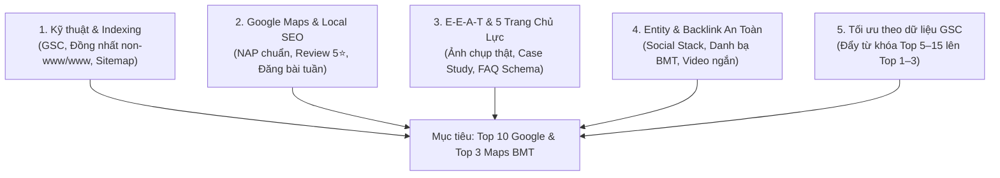

# Kế Hoạch & Lịch Trình 90 Ngày Đưa `suamaytinhbmt.id.vn` Lên Top 10 Google

> [!IMPORTANT]
> **Nền tảng bạn ĐÃ CÓ sẵn (vượt trội hơn đa số tiệm sửa máy tính địa phương):**
> - Website Next.js 15 tốc độ cao đặt tại Vercel Singapore (`sin1`) + Neon Postgres + Cloudflare R2.
> - Đầy đủ SEO kỹ thuật: `sitemap.xml` động, `robots.txt`, Canonical, OpenGraph, Schema `Article` / `Service` / `BreadcrumbList`, liên kết nội bộ 2 chiều Hub ↔ Spoke.
> - **19 bài viết SEO chuẩn** (89/89 link nội bộ hợp lệ, 0 thin content) + **8 trang dịch vụ** + công cụ độc quyền `/kiem-tra-may-tinh` & `/tra-cuu`.

Để bứt phá từ trạng thái **"đã có nền tảng tốt"** lên **Top 10 Google (và Top 3 Google Maps tại BMT)** cho các từ khóa ra tiền, website cần triển khai đồng bộ **5 trụ cột** dưới đây theo đúng thứ tự ưu tiên.

---

## 1. Kiến Trúc 5 Trụ Cột Đẩy Top 10 Google

---

## 2. Chi Tiết 5 Việc Bắt Buộc Phải Làm

### Trụ cột 1: Khai báo & Đồng bộ Google Search Console (GSC) — *Làm ngay trong 48 giờ*
1. **Xác minh quyền sở hữu trên Google Search Console:**
   - Gắn mã `googleSiteVerification` và `googleAnalyticsId` (GA4) trong trang `/admin/cai-dat` của website.
   - Gửi (Submit) lại `https://suamaytinhbmt.id.vn/sitemap.xml`.
   - Bấm **Kiểm tra URL → Yêu cầu lập chỉ mục (Request Indexing)** thủ công cho **5 trang chủ lực** (`/dich-vu/sua-may-tinh-tai-nha-bmt`, `/dich-vu/cai-win-10-11-phan-mem-tai-nha-bmt`, `/dich-vu/sua-laptop-windows`, `/dich-vu/nang-cap-ram-ssd-linh-kien`, `/bang-gia`) và 8 bài Giai đoạn 2 vừa xuất bản.
2. **Thống nhất 1 tên miền chính duy nhất (`https://suamaytinhbmt.id.vn` hoặc `www`):**
   - Hiện tại `NEXT_PUBLIC_SITE_URL` và `canonical` đang là `https://suamaytinhbmt.id.vn` (không có `www`).
   - Trên Vercel → **Settings → Domains**, hãy để `suamaytinhbmt.id.vn` là **Primary (Production)** và `www.suamaytinhbmt.id.vn` **Redirect 308 → `suamaytinhbmt.id.vn`** để Google không bị chia đôi sức mạnh giữa 2 phiên bản URL.

---

### Trụ cột 2: Google Business Profile (Google Maps) — *Đòn bẩy nhanh nhất vào Top 3 BMT*
Với từ khóa địa phương (*"sửa máy tính BMT"*, *"cài win tại nhà Buôn Ma Thuột"*), **Google Maps (Local Pack 3 kết quả đầu tiên)** chiếm tới **60% lượt gọi điện** và có thể lên Top trong **2 – 4 tuần** (nhanh hơn SEO web thuần):
1. **Chuẩn hóa NAP (Name – Address – Phone) giống hệt nhau 100%** trên Website, Google Maps, Facebook, Zalo:
   - Tên: `MQTech - Sửa Máy Tính & Laptop Tại Nhà BMT`
   - Địa chỉ: `Đường Võ Thị Sáu, P. Tân Lập, TP. Buôn Ma Thuột, Đắk Lắk`
   - SĐT: `0987 482 573`
   - Website: `https://suamaytinhbmt.id.vn`
2. **Chiến dịch Review 5 sao tự nhiên (Mục tiêu: 30+ đánh giá trong 90 ngày):**
   - Mỗi khách sửa xong, gửi tin nhắn Zalo kèm mã phiếu tra cứu bảo hành (`suamaytinhbmt.id.vn/tra-cuu`) và link đánh giá Google Maps.
   - Gợi ý khách nhắc tự nhiên dịch vụ vừa làm (VD: *"cài win tại nhà Tân Lập nhanh"*, *"vệ sinh laptop mát hẳn"*) — thuật toán Local SEO cực kỳ ưu tiên từ khóa trong review thật + ảnh chụp thật.
3. **Đăng cập nhật (Google Posts) 2 lần/tuần:**
   - 1 ảnh ca sửa thật + 3–4 dòng mô tả + nút **Tìm hiểu thêm** trỏ thẳng về 1 trong 5 trang chủ lực.

---

### Trụ cột 3: Nâng Cấp E-E-A-T Cho 5 Trang Chủ Lực (Thay Ảnh Thật + Case Study)
Google 2025–2026 đánh giá rất nặng yếu tố **Experience (Trải nghiệm thật)** — thứ đối thủ dùng AI copy bài không thể có:
1. **Thay ảnh stock bằng ảnh chụp thật tại tiệm/nhà khách:**
   - Ưu tiên thay ảnh thật trên 5 trang dịch vụ chủ lực + 4 bài phần cứng mới (mất nguồn, PC No Signal, WiFi, thay pin).
   - Ảnh chụp bằng điện thoại rõ nét: cảnh kỹ thuật tháo máy vệ sinh, máy đo nhiệt độ, màn hình trước/sau sửa, hóa đơn MQTech (che SĐT khách).
2. **Nâng cấp chiều sâu 3 trang dịch vụ chủ lực:**
   - Bổ sung mục **Câu hỏi thường gặp (FAQ)** chuẩn Schema `FAQPage` và cam kết thời gian có mặt từng phường BMT ngay trên trang `/dich-vu/sua-may-tinh-tai-nha-bmt`, `/dich-vu/cai-win-10-11-phan-mem-tai-nha-bmt`, `/dich-vu/sua-laptop-windows`.
3. **Duy trì 1 Case Study thật mỗi 2 tuần** (tương tự bài #11 *Kiến làm tổ trong màn hình*):
   - Mỗi bài Case Study thật trỏ 2 link trực tiếp về trang dịch vụ chủ lực.

---

### Trụ cột 4: Xây Dựng Entity & Backlink Địa Phương An Toàn (Off-Page SEO)
> [!CAUTION]
> **Tuyệt đối KHÔNG mua gói backlink giá rẻ, tool bắn link hay PBN rác.** Domain mới `.id.vn` rất nhạy cảm, dính spam link sẽ tụt mất index toàn bộ.

Thay vào đó, làm **100% Entity & Backlink sạch (miễn phí)**:
1. **Bộ Social Entity đồng bộ (Tuần 2–3):** Tạo/cập nhật đầy đủ hồ sơ cùng 1 tên thương hiệu, mô tả, địa chỉ, SĐT và gắn link `https://suamaytinhbmt.id.vn` trên:
   - Facebook Fanpage (đã có → đăng đều 2–3 bài/tuần kéo link về web)
   - Zalo Official Account / Zalo Cá nhân kinh doanh
   - YouTube Channel & TikTok (quay clip ngắn 20–40 giây cảnh vệ sinh laptop/test máy/sửa lỗi thật, gắn link web ở phần mô tả & bio)
   - Pinterest, LinkedIn Company, X (Twitter), Medium/Substack (đăng tóm tắt bài viết trỏ nguồn về web)
2. **Danh bạ doanh nghiệp & Local Citations Việt Nam (Tuần 3–4):**
   - Đăng ký thông tin tiệm trên: Trang Vàng Việt Nam (`trangvangvietnam.com`), Cốc Cốc Map (Cốc Cốc chiếm thị phần lớn trên máy tính văn phòng VN!), Bing Places, Apple Business Connect, các trang review/top dịch vụ Đắk Lắk – BMT.
3. **Kéo Traffic tự nhiên từ Công cụ miễn phí (`/kiem-tra-may-tinh`):**
   - Xuất bản cụm bài **Giai đoạn 3** (*Test bàn phím online*, *Kiểm tra điểm chết màn hình*, *Checklist mua laptop cũ*) và chia sẻ hữu ích trong các hội nhóm sinh viên ĐH Tây Nguyên, hội mua bán laptop cũ BMT → tạo tín hiệu người dùng thật (dwell time cao) cực tốt cho SEO.

---

### Trụ cột 5: Vòng Lặp Tối Ưu Theo Dữ Liệu Google Search Console (Từ Tuần 5 trở đi)
Mỗi 2 tuần, mở **Google Search Console → Hiệu suất (Performance)**:
- Lọc các từ khóa đang nằm ở **vị trí 5 – 20** (có lượt hiển thị cao nhưng chưa vào Top 3–5).
- Thực hiện 3 thao tác đẩy hạng tức thì cho đúng trang đó:
  1. Viết lại `seoTitle` hấp dẫn hơn để tăng tỷ lệ nhấp (CTR).
  2. Bổ sung 1 đoạn trả lời trực diện (40–60 từ) + bảng tóm tắt cho đúng truy vấn khách đang gõ (để ăn Featured Snippet / AI Overview).
  3. Bơm thêm 2–3 internal link có anchor text tự nhiên từ các bài viết có traffic cao nhất trỏ về trang đó.

---

## 3. Lịch Trình Thực Thi Cụ Thể 90 Ngày (12 Tuần)

| Giai đoạn | Thời gian | Công việc trọng tâm | Ai thực hiện | KPI / Kết quả kỳ vọng |
|---|---|---|---|---|
| **Bước chạy đà** *(Indexing & Maps)* | **Tuần 1** | - Đồng nhất Primary domain `suamaytinhbmt.id.vn` trên Vercel - Gắn GSC + GA4 vào `/admin/cai-dat`, submit `sitemap.xml`, Request Indexing 5 trang chủ lực + 8 bài mới - Chuẩn hóa NAP trên Google Maps + Cốc Cốc Map + Fanpage | Chủ tiệm + AI hỗ trợ | 100% URL (27+ trang) được Google index; Google Maps chuẩn 100% thông tin |
| **Củng cố chủ lực** *(E-E-A-T & Entity)* | **Tuần 2 – 3** | - Nâng cấp 3 trang dịch vụ chủ lực (thêm FAQ Schema + cam kết phường BMT) - Thay 10–15 ảnh chụp thật vào 5 trang chủ lực & bài phần cứng - Tạo bộ Social Entity (YouTube, TikTok, Pinterest, Bing Places, Trang Vàng) - Xin 5–8 đánh giá 5⭐ thật đầu tiên trên Google Maps | Chủ tiệm (chụp ảnh + xin review) + AI (nâng cấp code/content) | 5 trang chủ lực có 100% ảnh thật; hoàn tất 8–10 backlink Entity sạch; Maps bắt đầu lên Top 5–10 |
| **Bùng nổ Traffic** *(Giai đoạn 3 SEO)* | **Tuần 4 – 6** | - Xuất bản **6 bài Giai đoạn 3**: 3 bài kéo traffic cho `/kiem-tra-may-tinh` (test phím, test màn hình, checklist mua laptop cũ) + 3 bài cụm MacBook & nâng cấp SSD BMT - Đăng 2 Case Study thật từ ảnh chụp tại tiệm - Chia sẻ công cụ `/kiem-tra-may-tinh` vào hội sinh viên ĐH Tây Nguyên | AI viết bài + Chủ tiệm cung cấp ảnh ca sửa thật | Website đạt **25+ bài viết chất lượng**; bắt đầu có traffic tự nhiên hàng ngày từ Google & nhóm sinh viên |
| **Phủ Local BMT** *(Giai đoạn 4 SEO)* | **Tuần 7 – 9** | - Xuất bản **4–6 bài Local SEO phủ kín các phường BMT**: Ea Tam (ĐH Tây Nguyên), Tân Lợi, Tự An, Thành Công, Thắng Lợi, KCN Hòa Phú - Đạt mốc 15–20 đánh giá 5⭐ trên Google Maps - Quay & đăng 4–6 video ngắn 30s (TikTok/YouTube Shorts/Reels) gắn link web | AI viết bài + Chủ tiệm quay clip ngắn & đăng Maps | Nhiều từ khóa ngách địa phương (phường/lỗi cụ thể) vào **Top 1 – 5**; Google Maps vào **Top 3 Local Pack** |
| **Tối ưu bứt phá** *(Data-Driven SEO)* | **Tuần 10 – 12** | - Đọc báo cáo Google Search Console 60 ngày: lọc toàn bộ từ khóa **vị trí 5 – 15** - Tối ưu lại Title/Meta, bổ sung FAQ & bơm internal link đẩy nhóm từ khóa chủ lực (*sửa máy tính tại nhà BMT*, *cài win tại nhà BMT*, *sửa laptop BMT*, *vệ sinh laptop BMT*) vào **Top 1 – 10** - Rà soát tỷ lệ chuyển đổi (số lượt bấm Hotline/Zalo/Đặt lịch trên GA4) | AI phân tích dữ liệu GSC & tối ưu bài + Chủ tiệm | **Nhóm từ khóa chính địa phương vào Top 10** (nhiều từ vào Top 1–5); lượng khách gọi/đặt lịch từ Google ổn định hàng tuần |

---

## 4. Lịch Thao Tác Cố Định Hàng Tuần Cho Chủ Tiệm (Chỉ ~2 Giờ/Tuần)

Để duy trì đà tăng hạng bền vững mà không tốn nhiều thời gian vận hành tiệm:
- **Thứ 2 (20 phút):** Chụp 2–3 ảnh ca sửa thật trong tuần → đăng 1 bài ngắn lên **Google Maps** + **Fanpage** gắn link về 1 trang chủ lực.
- **Thứ 4 (15 phút):** Nhắn Zalo gửi mã tra cứu bảo hành + link đánh giá Google Maps cho 3–5 khách vừa sửa hài lòng.
- **Thứ 6 (30 phút):** Gửi ảnh + mô tả ngắn 1 ca sửa hay trong tuần cho AI biên tập thành bài Case Study hoặc cập nhật ảnh thật cho bài cũ.
- **Chủ nhật (15 phút):** Mở **Google Search Console** xem từ khóa nào đang tăng impressions/clicks để chọn chủ đề ưu tiên cho tuần sau.

---

## 5. Kỳ Vọng Thời Gian Thực Tế (Không Ảo Tưởng)
- **Tuần 2 – 4:** Google Maps + các từ khóa ngách địa phương dài (*"cài win tại nhà Tân Lập BMT"*, *"sửa lỗi 0x0000011b"*, *"kiến làm tổ trong màn hình laptop"*) bắt đầu vào **Top 1 – 10**.
- **Tháng 2 – 3:** Nhóm từ khóa cạnh tranh trung bình (*"vệ sinh laptop BMT"*, *"nâng cấp SSD BMT"*, *"bảng giá sửa máy tính BMT"*, *"bảo trì IT văn phòng BMT"*) vào **Top 5 – 10**.
- **Tháng 3 – 4:** Nhóm từ khóa cạnh tranh cao nhất (*"sửa máy tính tại nhà BMT"*, *"sửa laptop Buôn Ma Thuột"*, *"cài win tại nhà Buôn Ma Thuột"*) cạnh tranh trực diện **Top 1 – 5**.
